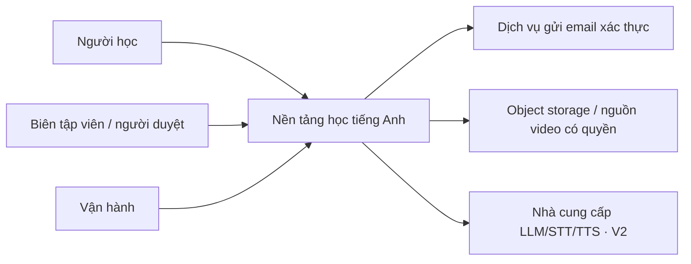
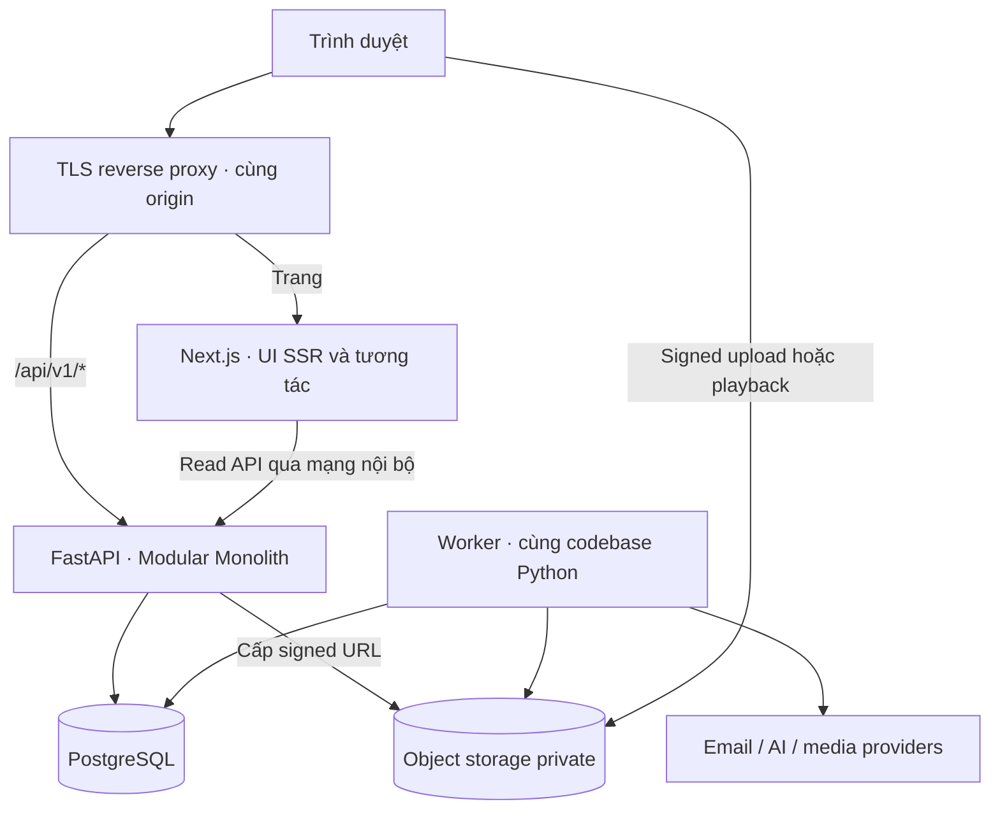
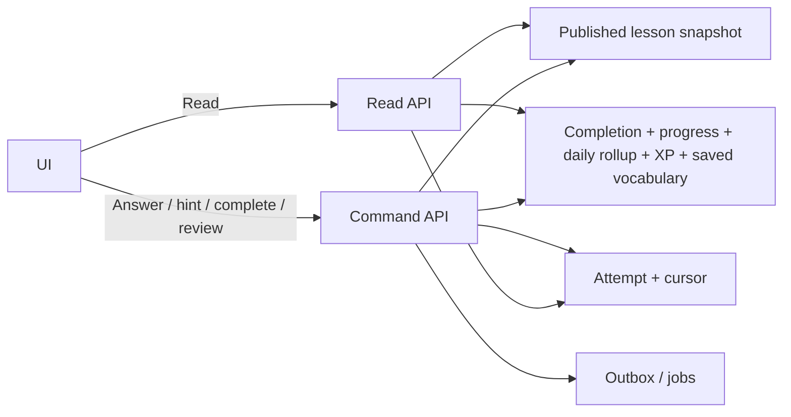
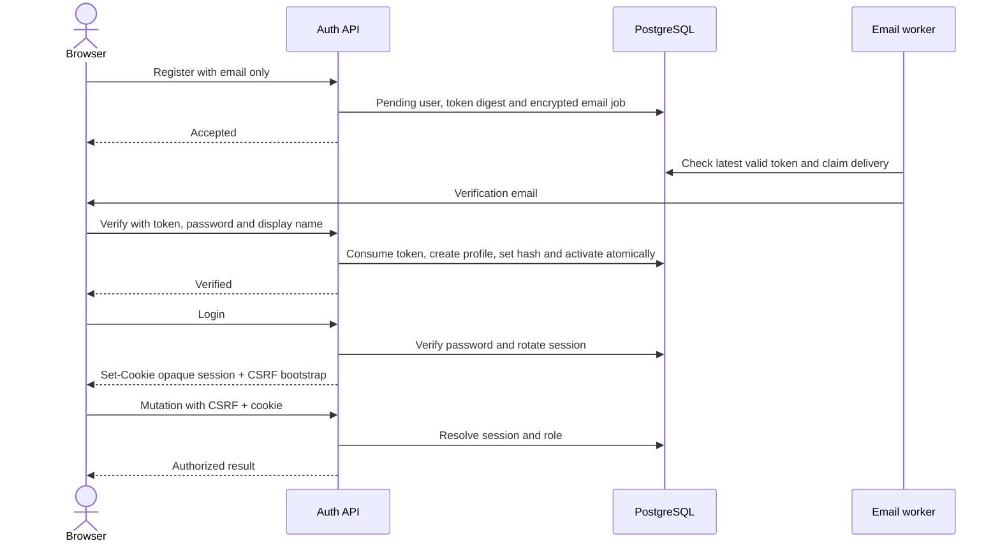
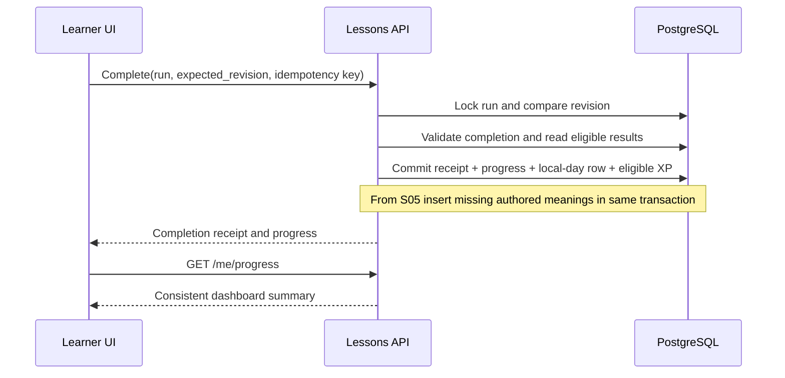

# Kiến trúc hệ thống

**PROPOSED.** Phạm vi là sản phẩm mới. Các tương tác quan sát được ở AIO English giúp xác định công việc của người học. Chúng không cung cấp kiến trúc nội bộ. Xem [khảo sát](../research/01-site-exploration.md) và [SRS sản phẩm](../requirements/02-SRS.md).

## Quyết định và ranh giới

| Quyết định | Hệ quả triển khai |
| --- | --- |
| Node.js 24, npm 11, Next.js App Router, React, TypeScript, Tailwind | Sprint 00 dựng web và smoke. Khi có nghiệp vụ, Server Components đọc nội dung công khai, Client Components xử lý bài tập và media, TanStack Query quản lý dữ liệu server giàu tương tác. |
| Python 3.13, uv 0.12.7, FastAPI, Pydantic, SQLAlchemy 2, Alembic | API có schema OpenAPI 3.1. Module Python sở hữu use case và ràng buộc dữ liệu của mình. Chạy worker cùng codebase khi phase cần. |
| Một PostgreSQL 17 | Một transaction cho completion, progress, XP và từ đã lưu khi các thành phần tương ứng đã phát hành. PostgreSQL giữ dữ liệu học tập, tài khoản và xuất bản. |
| API cùng origin | Next chuyển tiếp local và TLS reverse proxy phục vụ production. HTTP nghiệp vụ dưới `/api/v1/`. Health nằm tại `/health/live` và `/health/ready`. Cookie phiên và CSRF được triển khai từ Sprint 01. |
| Object storage private | API quyết định quyền và phát URL ngắn hạn để trình duyệt tải trực tiếp. Media có phiên bản và trạng thái ingest. |
| Hàng đợi PostgreSQL khi có tác vụ bất đồng bộ | Lấy job bằng lease, xử lý at-least-once với khóa dedupe. Có thể chuyển Redis/job broker sau khi đo tải và contention. |
| LLM/STT/TTS theo giai đoạn | Giao tiếp qua adapter nhỏ trong cùng codebase. Hàng đợi, giới hạn tài nguyên, opt-in và tách điểm học chính thức khỏi phản hồi AI. |

Sprint 00 dựng một monorepo gồm `apps/web` và `apps/api`, môi trường PostgreSQL/Alembic baseline, health và CI. MVP gồm truy cập/onboarding, roadmap, CMS, gõ mặc định và nghe gõ, tiến độ, XP cá nhân, tự lưu từ sau bài và ghi danh SRS tường minh. V1 thêm nghe và nói tự xác nhận, grammar, dictionary, đọc/dịch, video/dictation, IPA/shadowing. V2 thêm AI, streak, leaderboard, thành tích và cá nhân hóa. Social có lộ trình riêng nếu duyệt. Mỗi release qua cổng Sprint 12. [ADR công cụ](adr/0001-local-toolchain-and-monorepo.md) · [ADR HTTP](adr/0002-http-and-deployment-baseline.md) · [ADR học tập](adr/0003-learning-variants-rewards-vocabulary.md)

## Sơ đồ ngữ cảnh

## Sơ đồ container

## Luồng dữ liệu

- Chỉ bản nội dung đã xuất bản được đọc từ API learner. `lesson_id` ổn định và version bất biến sau publish. Run Gõ câu ghim version, mode và difficulty cho mọi lệnh và feedback. Một run đang làm mỗi lane, chuyển lane giữ nguyên run trước và replay cần hành động riêng.
- API lấy `user_id` từ session. Mọi lệnh chấm/ghi nhận kiểm tra quyền sở hữu, run, version, item và cursor; DTO công khai loại đáp án trước reveal.
- Lệnh duplicate cùng `Idempotency-Key` và body hash phát lại kết quả. Cùng key và body khác trả 409. Row lock/unique constraint vẫn đảm bảo bất biến khi client đổi key hoặc chạy song song.
- Sau submit hợp lệ, response có revision và view mới của run. UI hiển thị feedback theo receipt đã commit, sau đó invalidate progress. Worker gửi email, xử lý media/AI và projection phụ với retry có giới hạn. Tính khả dụng của worker không làm lệch kết quả typing hoặc SRS.
- Chấm, lịch ôn, tổng hợp và xuất bản lưu thời điểm dạng UTC. Local study date suy ra trên server từ timezone IANA đã cấu hình, đóng băng tại event. Báo cáo cá nhân theo event time; đồng hồ client chỉ dùng cho hiển thị.
- API có phân trang cursor, kiểu lỗi chung, audit khi có quyền cao. Viewer công khai có thể cache content theo version; dữ liệu session/progress luôn private/no-store.

## Authentication

Token xác minh/reset dùng một lần; database giữ digest và ciphertext tạm dành cho giao thư. Người dùng tạo mật khẩu sau khi có token xác minh mới nhất rồi đăng nhập riêng. Logout thu hồi session hiện tại; reset thu hồi toàn bộ. Yêu cầu xuất/xóa dữ liệu cần xác thực lại trong phiên hiện tại, hiệu lực 10 phút. API owner-only cung cấp trạng thái và cấp link xuất riêng tư thời hạn ngắn. Chi tiết TTL, khóa và quyền tại [kiến trúc backend](03-backend-architecture.md).

## Lưu tiến độ

Completion ghi tối đa một receipt cho mỗi run. Dashboard đếm lesson distinct trong ngày, XP ghi một lần cho lần hoàn tất graded đủ điều kiện của mỗi learner/lesson. Kho từ tự lưu từ Sprint 05 dựa trên sense đã ghim vào mục bắt buộc, giữ lượt bỏ lưu và chỉ tạo thẻ SRS khi learner chủ động ghi danh. [Engine](06-exercise-engines.md)

## Chỉ mục đặc tả

[Frontend](02-frontend-architecture.md) · [Backend](03-backend-architecture.md) · [PostgreSQL](04-database-design.md) · [REST API](05-api-specification.md) · [Typing/SRS/translation](06-exercise-engines.md) · [Triển khai/media/AI](07-deployment-architecture.md).

