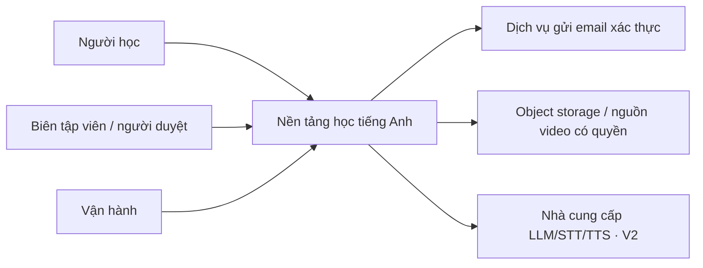
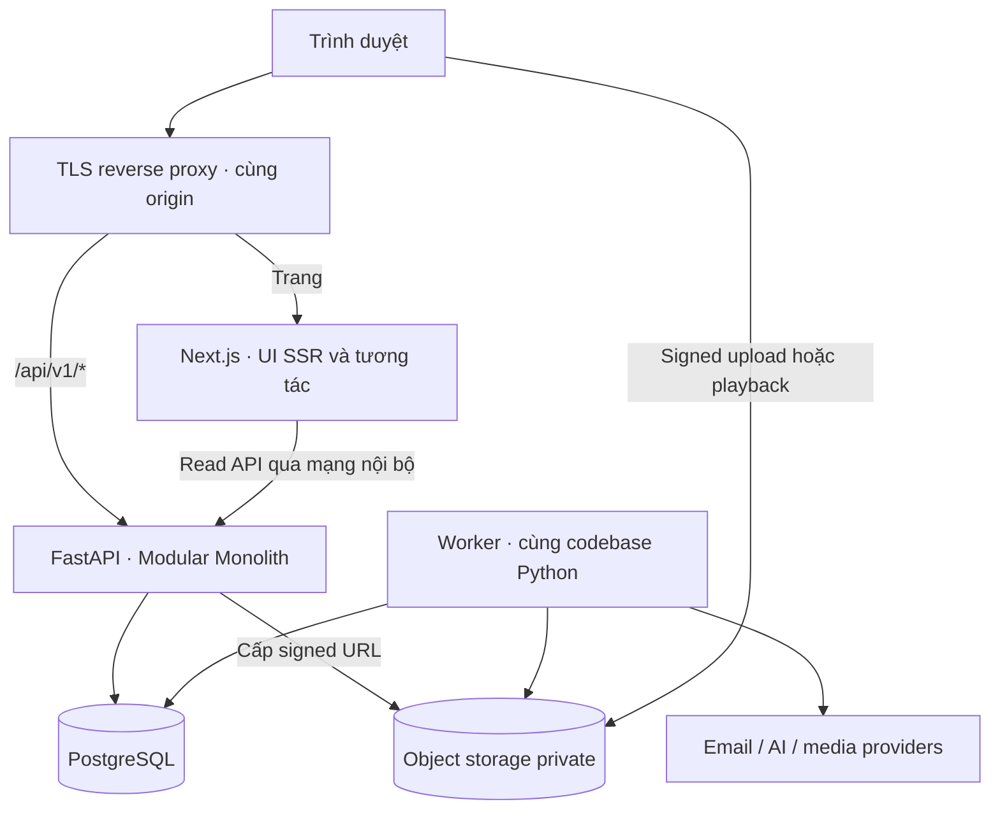
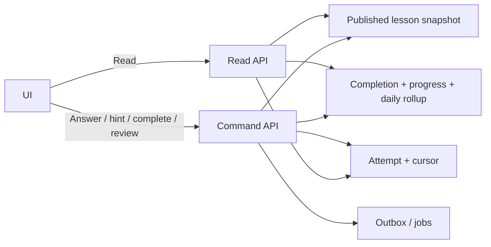
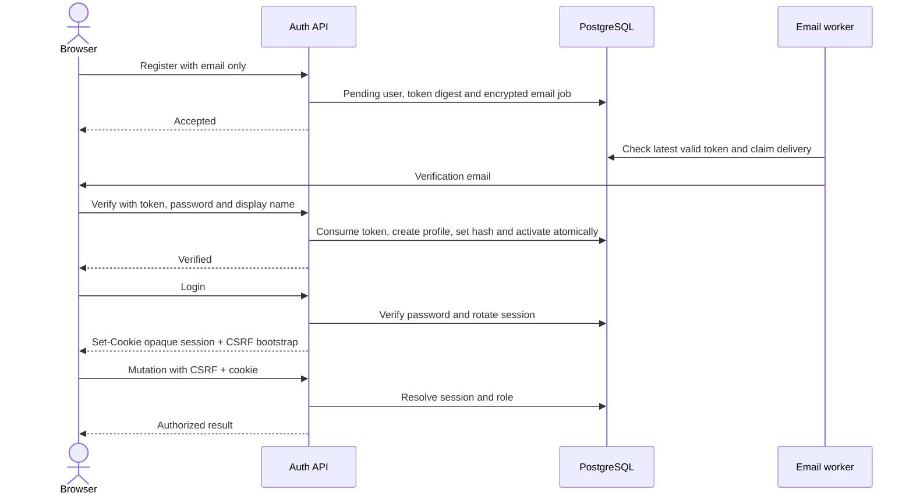
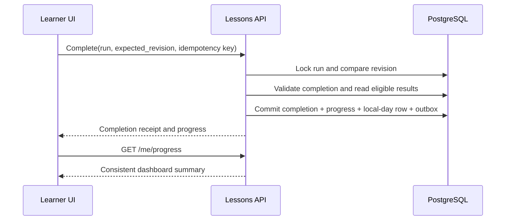

# Kiến trúc hệ thống

**PROPOSED.** Phạm vi là sản phẩm mới. Các tương tác quan sát được ở AIO English giúp xác định công việc của người học. Chúng không cung cấp kiến trúc nội bộ. Xem [khảo sát](../research/01-site-exploration.md) và [SRS sản phẩm](../requirements/02-SRS.md).

## Quyết định và ranh giới

| Quyết định | Hệ quả triển khai |
| --- | --- |
| Next.js App Router, React, TypeScript, Tailwind, shadcn/ui | Server Components cho nội dung công khai có thể cache. Client Components cho nhập bài, âm thanh và tương tác. TanStack Query sở hữu dữ liệu server giàu tương tác. |
| Python, FastAPI, Pydantic, SQLAlchemy 2, Alembic | API có schema và OpenAPI. Module Python sở hữu use case, domain invariant và truy cập bảng của mình. Chạy worker từ cùng container image khi cần. |
| Một PostgreSQL | Giao dịch duy nhất cho bài hoàn thành, tiến độ, XP và outbox. PostgreSQL là nguồn sự thật cho học tập, tài khoản và xuất bản. |
| Reverse proxy cùng origin | HTML ở Next, `/api/v1/` ở FastAPI. Session cookie opaque và CSRF cho thao tác có ghi. |
| Object storage private | API quyết định quyền và phát URL ngắn hạn để trình duyệt tải trực tiếp. Media có phiên bản và trạng thái ingest. |
| Hàng đợi PostgreSQL khi có tác vụ bất đồng bộ | Lấy job bằng lease, xử lý at-least-once với khóa dedupe. Có thể chuyển Redis/job broker sau khi đo tải và contention. |
| LLM/STT/TTS theo giai đoạn | Giao tiếp qua adapter nhỏ trong cùng codebase. Hàng đợi, giới hạn tài nguyên, opt-in và tách điểm học chính thức khỏi phản hồi AI. |

MVP gồm truy cập/onboarding, roadmap, CMS, typing, tiến độ và từ vựng/SRS. V1 thêm grammar, dictionary, đọc/dịch, video/dictation, IPA/shadowing. V2 thêm AI, gamification và cá nhân hóa; social có thể lên sau. Mỗi release qua cổng kiểm thử/triển khai Sprint 12. Monolith giảm bề mặt vận hành ở tải khởi đầu và giữ các mutation học tập trong một commit. Tách đọc nặng hay media chỉ sau khi số liệu chứng minh cần.

## Sơ đồ ngữ cảnh

## Sơ đồ container

## Luồng dữ liệu

- Chỉ bản nội dung đã xuất bản được đọc từ API learner. `lesson_id` ổn định, `version_id` bất biến sau publish. `lesson_run` giữ version cho tất cả lệnh và feedback.
- API lấy `user_id` từ session. Mọi lệnh chấm/ghi nhận kiểm tra quyền sở hữu, run, version, item và cursor; DTO công khai loại đáp án trước reveal.
- Lệnh duplicate cùng `Idempotency-Key` và body hash phát lại kết quả. Cùng key và body khác trả 409. Row lock/unique constraint vẫn đảm bảo bất biến khi client đổi key hoặc chạy song song.
- Sau submit hợp lệ, response có revision và view mới của run. UI hiển thị feedback theo receipt đã commit, sau đó invalidate progress. Worker gửi email, xử lý media/AI và projection phụ với retry có giới hạn. Tính khả dụng của worker không làm lệch kết quả typing hoặc SRS.
- Chấm, lịch ôn, tổng hợp và xuất bản lưu thời điểm dạng UTC. Local study date suy ra trên server từ timezone IANA đã cấu hình, đóng băng tại event. Báo cáo cá nhân theo event time; đồng hồ client chỉ dùng cho hiển thị.
- API có phân trang cursor, kiểu lỗi chung, audit khi có quyền cao. Viewer công khai có thể cache content theo version; dữ liệu session/progress luôn private/no-store.

## Authentication

Token xác minh/reset dùng một lần; database giữ digest và ciphertext tạm dành cho giao thư. Người dùng tạo mật khẩu sau khi có token xác minh mới nhất rồi đăng nhập riêng. Logout thu hồi session hiện tại; reset thu hồi toàn bộ. Yêu cầu xuất/xóa dữ liệu cần xác thực lại trong phiên hiện tại, hiệu lực 10 phút. API owner-only cung cấp trạng thái và cấp link xuất riêng tư thời hạn ngắn. Chi tiết TTL, khóa và quyền tại [kiến trúc backend](03-backend-architecture.md).

## Lưu tiến độ

## Chỉ mục đặc tả

[Frontend](02-frontend-architecture.md) · [Backend](03-backend-architecture.md) · [PostgreSQL](04-database-design.md) · [REST API](05-api-specification.md) · [Typing/SRS/translation](06-exercise-engines.md) · [Triển khai/media/AI](07-deployment-architecture.md).

