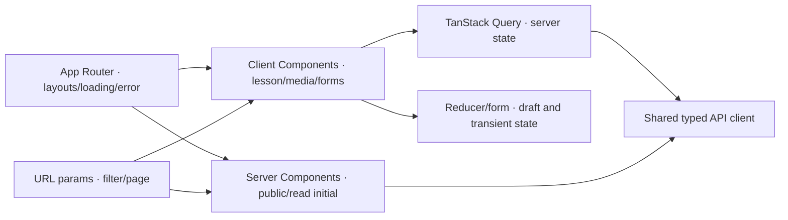

# Kiến trúc frontend

Kiến trúc sử dụng Next.js App Router, React, TypeScript strict và Tailwind trên Node.js 24, npm 11. Workspace web dùng lockfile npm ở root. Các route nghiệp vụ trong tài liệu là đặc tả theo phase. [ADR công cụ](adr/0001-local-toolchain-and-monorepo.md)

## Cấu trúc dự kiến

```text
apps/web/
  app/(public)/                  landing, demo, legal
  app/(auth)/                    login, register, verify, recover
  app/(learn)/                   onboarding, dashboard, roadmap, lessons/[lessonId],
                                 learn/[runId], vocabulary, review, settings
  app/(admin)/cms/               import, editor, review, audit
  features/                      auth, curriculum, typing, progress, vocabulary, srs,
                                 grammar, dictionary, reading, translation, video,
                                 pronunciation, shadowing, feedback, cms
  components/ui/                 primitives, dialog, field, icon button, notice
  components/shell/              desktop nav, mobile nav, breadcrumb, page boundary
  lib/api/                       client, problem decoder, generated schema.d.ts
  lib/telemetry/                 allowlisted events
  tests/e2e/                    Playwright
```

| Luồng | Route nhóm | Đọc/ghi | Kết quả |
| --- | --- | --- | --- |
| Public và preview | `/`, `/demo`, `/legal/*` | Dùng snapshot công khai và demo đã biên soạn | Demo không tạo kết quả người học; chạy bằng sample original. |
| Auth & onboarding | `/login`, `/register`, `/verify`, `/recover` trong `(auth)`, `/onboarding` trong `(learn)` | Auth API và `PUT /me/preferences` | Đăng ký chỉ nhập email. Link xác minh mở form mật khẩu và tên hiển thị, sau thành công chuyển tới login. Onboarding chọn CEFR, mục tiêu thi tùy chọn, locale vi/en mặc định vi và múi giờ IANA. Mục tiêu thời gian mở Sprint 04. Layout cho người đã có phiên vào onboarding trước khi kiểm onboarding hoàn tất ở các route học còn lại. |
| Học | `/dashboard`, `/roadmap`, `/lessons/[lessonId]`, `/learn/[runId]` trong `(learn)` | Curriculum, lesson-runs, progress | Lesson detail lấy lane và active run. Player lấy run theo ID. |
| Từ vựng | `/vocabulary`, `/vocabulary/[deckId]`, `/review`, `/dictionary` | Decks/cards/entries/reviews | Truy vấn due theo cursor và lưu mục từ từ tra cứu. |
| Kỹ năng | `/grammar`, `/grammar/[lessonId]`, `/reading`, `/reading/[lessonId]`, `/videos`, `/videos/[lessonId]`, `/pronunciation`, `/pronunciation/[soundId]` | Danh mục lesson theo kind, media, transcript | Danh mục theo trình độ; trang detail kỹ năng dùng cùng LessonRef, phiên thi/luyện mở tại `/learn/[runId]`. Video detail có query `mode` đồng bộ với bộ điều khiển. `soundId` là lesson ID của bài IPA đã công bố. |
| Cá nhân | `/progress`, `/settings`, `/help`, `/social` sau V2 | User scoped API | Progress, mục tiêu, tùy chọn, feedback, gamification khi bật. |
| CMS | `/cms`, `/cms/imports/[importId]`, `/cms/lessons/[id]`, `/cms/review` | CMS scope, import và publish | Read-only preview theo quyền và version, validation gắn dòng/field. |

## Sơ đồ frontend



### Tổ chức và dữ liệu

- Route group được tạo khi có route thật. Route giữ layout, loading/error boundary và metadata. Feature folder giữ cách phối hợp query/command, reducer và component nghiệp vụ. Sprint 00 xuất OpenAPI từ FastAPI, chạy `npm run api:types` ở root để sinh `lib/api/schema.d.ts`. Trình duyệt gọi URL tương đối qua proxy cùng origin. [ADR HTTP](adr/0002-http-and-deployment-baseline.md)
- Learner server route gửi cookie đến API nội bộ qua wrapper allowlist headers và dùng `cache: no-store`. Protect bằng redirect UI cho UX; API vẫn xác thực, phân quyền và kiểm ownership. CMS link được ẩn theo quyền, quyết định cấp quyền thực thi tại API.
- Query key convention `[resource, userScope, filters]` cho dữ liệu riêng. Dùng `runId` cho player. Lesson detail nhận readiness và kết quả theo version/mode/difficulty. Clear toàn bộ cache private khi đổi session. Public snapshot cache theo version, bản current pointer có TTL hoặc revalidate khi publish.
- Filter/search/selected tab được quản trong URL nếu có ý nghĩa chia sẻ hoặc back. Text draft giữ theo run/item trong memory đối với typing. Bản nháp dịch V1 dùng API theo run/item và revision riêng, không giữ lâu sau khi submit hoặc hoàn tất. Chỉ xem xét `sessionStorage` có TTL với dữ liệu học tối thiểu, dọn khi logout. Zustand chỉ khi có trạng thái trình phát hoặc shell dùng xuyên route mà React context cục bộ không đủ.
- Typing và grammar gõ bằng controlled form; Enter submit nếu IME đã commit và textarea ở mode có Enter submit. Một lần submit dùng cùng key khi timeout/retry, key mới khi sửa nội dung. Giữ draft khi 503/network. Chặn double click để UX gọn, API kiểm tra duplicate riêng.
- Lesson detail hiển thị hai trục Gõ câu, chỉ mở cặp server báo khả dụng, gắn Resume với ID của lane đang làm và Học lại với intent replay của lane completed. Chuyển lane qua lesson detail giữ run cũ. 409 đối chiếu current item hoặc active run và 410 về bài khả dụng khi snapshot bị thu hồi. Tổng kết tách first-attempt accuracy, terminal score, trợ giúp, mastery, XP và số từ tự lưu theo phase. V1 nghe và nói dùng playback cục bộ và self-ack. [Engine](06-exercise-engines.md)
- Chuyển trạng thái trên client: `loading → ready → submitting → feedback → next|complete`. 409 stale revision: refetch run rồi hiển thị item thực, giữ nháp cũ để người học sao chép nếu phù hợp. 422 hiển thị lỗi ngay tại trường, không tăng attempt. 401 đưa về đăng nhập và giữ return path nội bộ; 403 yêu cầu quay lại danh mục. Loading skeleton, empty rõ nguyên nhân và CTA.
- Không optimistic score/completion. Learning UI dùng server receipt cho next item, feedback và thống kê. Review chỉ rút card khỏi queue sau response, không bù điểm bằng đồng hồ client.
- Audio dùng native audio/video control hoặc accessible controls; URL media hết hạn → làm mới URL một lần. Transcript dùng cue bắt đầu/kết thúc theo ms, active cue theo media currentTime, người học có thể tắt auto-scroll. Caption song ngữ bố trí hai dòng độc lập; playback, transcript, review state tách rời.
- AI job poll có backoff theo `Retry-After`; pending/timeout hiển thị thông tin, cho quay lại bài. Không chèn HTML model/biên tập thô vào DOM. Text format từ schema và allowlisted markup qua sanitizer.
- Privacy settings yêu cầu nhập lại mật khẩu cho cả export/erase, với thời hạn 10 phút của session. Xác nhận xóa rõ ràng trước khi tạo job; theo dõi trạng thái qua API riêng. Chỉ nút Tải dữ liệu của export hoàn tất mới xin URL riêng tư ngắn hạn. Link xác minh/reset mang token trong fragment; nhập vào state bộ nhớ rồi xóa fragment khỏi URL. Đặt Referrer-Policy: no-referrer cho hai màn hình. Giữ token email, mật khẩu và URL ký sẵn ngoài telemetry và logs.
- CMS dùng tải signed PUT riêng, preview hiện trạng thái checksum/media. Download báo lỗi CSV là tệp do server sinh, tránh formula injection. Publish cần xác nhận version và quyền, show errors theo field và giữ sửa nháp.

## Thiết bị và trợ năng

Desktop có sidebar, content hierarchy và thanh tiến độ bài. Mobile có điều hướng compact, một cột và thao tác chính cố định nếu không che keyboard. Transcript/media và điều khiển đánh giá xuống dưới hoặc đổi thứ tự phù hợp với viewport. Tập trung focus vào heading sau nav và giữ focus giữa input/feedback. Cho phép replay trực quan, `aria-live` feedback vừa đủ, thông báo lỗi liên kết field, phím skip, tab order ở dialog. Font và ngôn ngữ EN/VI truyền đúng `lang`; chỉnh 200% zoom, chiều ngang 320 CSS px và reduced-motion. Xác nhận chống tràn với input dài, không phá dòng giữa glyph/ký tự IPA. Xem [đặc tả màn hình](../design/03-screen-specifications.md) và [NFR](../requirements/05-non-functional-requirements.md).

