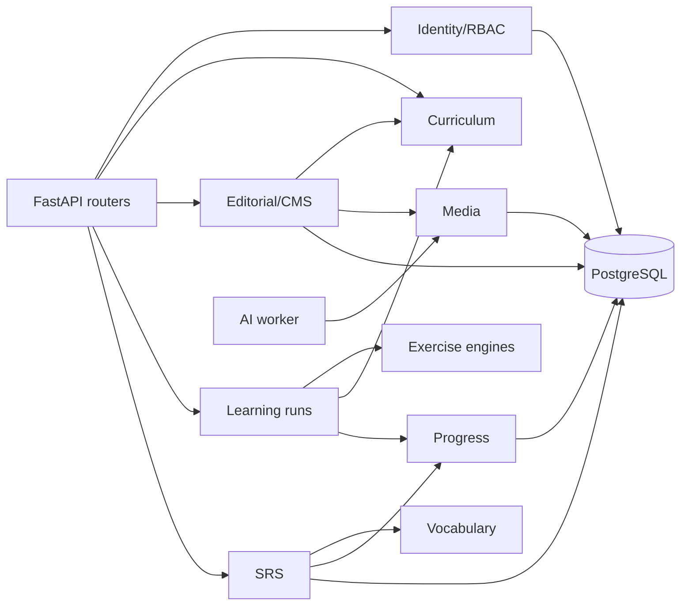

# Kiến trúc backend

**PROPOSED.** Một FastAPI service xử lý HTTP, một worker tùy giai đoạn dùng chung codebase và PostgreSQL. Giữ transaction boundary ở application use case và ràng buộc lâu dài ở database.

## Biên module

| Module | Sở hữu | Interface dùng bởi |
| --- | --- | --- |
| `identity` | Users, opaque session, email/reset, RBAC, profile, preferences, owner-scoped privacy requests | Middleware xác thực và lấy timezone, CMS role guard. |
| `curriculum` | Course → Unit → Lesson, prereq/recommendation, đọc published snapshot | Dashboard, run factory, catalog, content. |
| `editorial` | Soạn version, review, import, publish, audit | Write-side curriculum; media readiness check. |
| `learning` | Run, prompt cursor, hints, attempts, completion | Dùng pure graders và đồng bộ progress. |
| `engines` | Pure typing/grammar/sample reference/rubric, không DB/provider | Learning use case; AI rubric dùng envelope chung. |
| `progress` | Progress per lesson, daily goal/activity, study sessions; reward sau V2 | /me/progress, mutate trong completion/review transaction. |
| `vocabulary` | Lexical entries/senses, decks, personal saved entries | Dictionary read và review selector theo entry. |
| `review` | Card, SM-2 state, due query, review history | Vocabulary enroll, progress/streak accrual. |
| `media` | Asset object và cue metadata validation/access | Editorial, curriculum, pronunciation, videos. |
| `ai` | Consented feedback request, model adapter, budget, recorded result | Translation/shadowing V2, processing worker. |
| `engagement` | Optional social, achievements, help queue | Progress reward event, settings/privacy. |

Module Python có `router.py`, `schemas.py`, `service.py` và model/repository khi cần. `database` giữ session factory, migrations. Cổng media/email/AI có implementation cụ thể và stub cho test; domain nội bộ gọi typing/alignment trực tiếp. Cấm gọi HTTP vòng qua các module trong monolith. Read model có thể join module qua view/query đã thống nhất, write do module sở hữu.

## HTTP và quyền

- Pydantic DTO phân biệt public/read, command, editor, provider. Mutation kiểm tra schema, rồi tenancy/ownership/role, trạng thái, version và revision. Trả `application/problem+json` với `code`, `request_id` và lỗi trường khi có. Gắn correlation ID, tránh nội dung bài nộp, secret và URL media có chữ ký trong logs.
- Session opaque 32 byte CSPRNG, lưu digest SHA-256, cookie `__Host-elp_session` Secure, HttpOnly, SameSite=Lax, Path=/; idle 14 ngày và hard 30 ngày là defaults. Tạo session mới khi đăng nhập, revoke khi logout/reset. Phản hồi auth cung cấp cờ onboarding dựa trên ngày hoàn tất thiết lập lần đầu. Mọi mutation yêu cầu CSRF bound to session (HMAC-SHA256 trên session ID với secret CSRF riêng, constant-time verify), kiểm Origin và HTTPS; guest forms dùng token double-submit tương đương, tránh login CSRF. Read API hỗ trợ bootstrap CSRF trong response private. Mật khẩu Argon2id, min 12 và max 128 ký tự, reject sau rate-limit khi cần. Recovery link 30 phút, verify link 24h. Đăng ký/resend/recovery trả 202 chung và có rate limit theo email chuẩn hóa/IP. Redis chưa là yêu cầu.
- Role `learner`, `editor`, `reviewer`, `admin`. Author không tự duyệt version của mình qua API. Admin publish version đã được reviewer độc lập duyệt. Reviewer/role grant cần audit. Học viên sở hữu run/card/preferences; đọc resource người khác trả 404 hoặc 403 theo contract. Draft answer keys, private rubrics và signed URLs không được trả từ list public.

## Xác minh email và quyền dữ liệu

- Register nhận email, chèn pending user bằng unique email_norm, khóa hàng user trước khi thao tác token. User active/deactivated nhận phản hồi chung; register và resend chỉ phát proof cho pending user và không sửa profile/hash. Khi phát mới, mark proof cũ superseded trong cùng transaction. Verification khóa user rồi proof, đối chiếu digest, purpose, TTL, chưa consumed/superseded và trạng thái pending. Consume proof, set Argon2id hash, tạo profile và activate cùng transaction; thất bại rollback cả proof lẫn profile. Hai request xác minh cạnh tranh chỉ có một thành công. Verify không tự phát phiên; người dùng đăng nhập sau bước này. Recovery chỉ chạy cho tài khoản active; reset đổi hash, consume proof và revoke mọi session trong cùng transaction.
- Ghi email job cùng transaction phát token. Queue record chứa user_id, token_id, purpose và ciphertext AEAD dùng KMS/key ID. Bind các ID, purpose và expires_at làm associated data để token không dùng chéo; quyền giải mã chỉ cấp cho worker giao email. Database/logs không có raw token. Worker kiểm active/latest/purpose/expiry trước khi gửi, bỏ proof hết hạn hoặc bị thay thế. Xóa ciphertext khi gửi thành công, hết hạn hoặc superseded; retry ghi metadata an toàn. Nếu email cũ đang in-flight khi resend, proof cũ vẫn bị từ chối ở API verify.
- Authenticated reauth kiểm mật khẩu đang dùng, rate-limit và đặt reauthenticated_at cho đúng session, có hiệu lực 10 phút. Export và erase đều kiểm fresh session tại thời điểm tạo request; erase thêm bước xác nhận ở UI. Tạo owner-linked privacy_requests và job đồng giao dịch, log loại yêu cầu/correlation và trạng thái, dữ liệu xuất chỉ ghi vào private storage ngắn hạn. Status/download kiểm owner và session; download xuất URL ngắn hạn sau khi export ready, không embed URL vào job status hay log. Erasure worker thu hồi session khi bắt đầu thực thi, chặn sign-in và xử lý dữ liệu DB/object/jobs theo retention. Các bước xóa ngoài DB có retry idempotent; chỉ ghi audit tối thiểu theo chính sách lưu trữ.

## Giao dịch, xung đột và sự kiện

- Tạo run đảm bảo một `active` trên tuple user/lesson/version/mode, kiểm active qua unique partial index. `GET run` trả current item và revision; status `active/completed/abandoned`. App retry giữ cùng khóa.
- Với command có idempotency, scope là `user_id + operation_id + Idempotency-Key`; body hash từ method, resource IDs và canonical JSON, bao gồm expected revision. Chèn reservation trước mutation trong cùng transaction. Unique conflict chờ transaction trước, sau commit đọc receipt. Cùng hash replay response đã lưu, khác hash trả `409 IDEMPOTENCY_CONFLICT`. Transient 5xx rollback reservation, retry cho phép. TTL receipt ít nhất 7 ngày, durable constraints bảo vệ completion và reviews sau TTL. Không dùng body response cache cho credential hoặc signed URL.
- `SELECT FOR UPDATE` lock run/card rows, sau đó kiểm revision/stale item. Chính sách lock completion: idempotency → run → progress lesson row → daily row → reward/outbox. Nếu Giao dịch bulk CMS chạm nhiều lesson, đặt thứ tự theo ID. Deadlock/serialization retry hữu hạn với jitter, giữ idempotency.
- Attempt và review log append-only. Khi đúng hoặc chấp nhận reveal theo mode, mutation trả item result và cursor; hint có counter riêng và bị giới hạn bởi policy. Completion yêu cầu items terminal, unique theo run, cập nhật best/last và bảng ngày trong cùng commit. V2 nhận XP cho lần hoàn thành đầu của lesson đủ điều kiện; key là user + loại nguồn + lesson ID. Review nhận thưởng theo policy sự kiện riêng nếu rollout bật. Reward unique theo source; projection bổ sung đẩy qua outbox trong cùng commit và consumer có dedupe.
- Run version luôn được pin. Mark “superseded” ở mức catalog pointer; run cũ đọc version cũ đã publish. Nếu nội dung bị gỡ quyền, áp dụng flags access revoke hoặc media block trong read path riêng và audit, không rewrite lịch sử.
- Worker lấy job PostgreSQL qua FOR UPDATE SKIP LOCKED, set lease và attempt rồi nhả txn trước IO. Heartbeat chỉ khi job dài; dead lease có thể nhận lại. Finalize theo job id và lease owner; insert result/outbox với dedupe key. Retry exponential jitter giới hạn, trạng thái dead/needs manual review sau max attempts. API trả 202 cùng status URL.
- Privacy/export/delete theo lifecycle đã công bố. Bất biến lịch sử dành cho hoạt động bình thường; quy trình xóa có thẩm quyền xử lý riêng, quyền DB giới hạn và audit.

## Chuẩn vận hành tối thiểu

`GET /health/live` kiểm process, `GET /health/ready` kiểm DB/schema compatibility, không gọi external provider trong readiness. API dependencies được inject theo request. Metrics về rate/error/duration, conflicts, query wait, lease age, outbox lag, completions, retries và queue backlog. Bộ lỗi transient có retry hints cụ thể. Integration tests dùng PostgreSQL thật để kiểm unique lock/idempotency và migrate/revert schema phù hợp. Chi tiết [database](04-database-design.md), [API](05-api-specification.md) và [triển khai](07-deployment-architecture.md).

