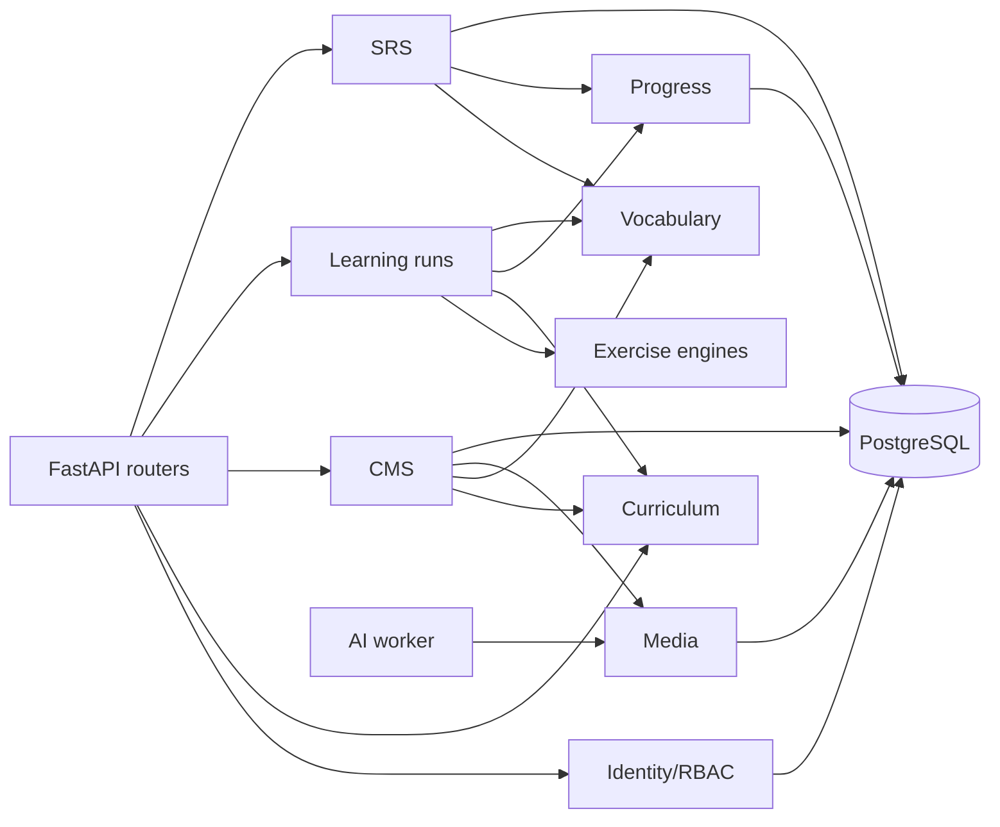

# Kiến trúc backend

Một FastAPI service xử lý HTTP. Khi phase cần xử lý bất đồng bộ, worker dùng chung codebase và PostgreSQL 17. Application use case sở hữu transaction, database giữ ràng buộc lâu dài. Mô tả các module nghiệp vụ bên dưới là đặc tả theo phase. [ADR công cụ](adr/0001-local-toolchain-and-monorepo.md)

## Biên module

| Module | Sở hữu | Interface dùng bởi |
| --- | --- | --- |
| `identity` | Users, opaque session, email/reset, RBAC, profile, preferences, owner-scoped privacy requests | Middleware xác thực và lấy timezone, CMS role guard. |
| `curriculum` | Course → Unit → Lesson, prerequisite và snapshot bài đã xuất bản | Dashboard, run factory, catalog. |
| `cms` | Import, review, publish, audit và liên kết target vào snapshot | Write-side curriculum, media readiness và provenance. |
| `learning` | Run, prompt cursor, hints, attempts, completion | Dùng grader thuần, phối hợp progress và từ đã lưu trong transaction. |
| `exercises` | Grader thuần cho typing, grammar và reference/rubric | Learning use case, AI rubric dùng envelope chung. |
| `progress` | Progress theo lesson, daily goal/activity, study sessions và ledger XP MVP | /me/progress, cập nhật cùng completion/review. |
| `vocabulary` | Identity mục từ và nghĩa từ S02. Deck, kho cá nhân, tombstone và auto-save từ S05 | CMS ghim nghĩa; dictionary đọc và SRS chọn nghĩa khi learner yêu cầu. |
| `srs` | Card theo nghĩa/chiều, SM-2 state, due và review history | Ghi danh tường minh, cập nhật progress khi review đã commit. |
| `grammar`, `dictionary`, `reading`, `translation` | Nội dung và DTO riêng cho các kỹ năng V1 | Curriculum snapshot, learning và vocabulary. |
| `media`, `video`, `pronunciation` | Asset validation/access, transcript cues và audio/phát âm versioned | CMS, curriculum, typing và trang kỹ năng. |
| `ai` | Consented feedback request, model adapter, budget, recorded result | Translation/shadowing V2, processing worker. |
| `support`, `gamification`, `social` | Góp ý cá nhân, streak/leaderboard/thành tích V2 và tương tác xã hội tùy chọn | Progress ledger, settings và privacy. |

Entry point là `app.main:app` trong `apps/api`; các module nằm trực tiếp dưới `apps/api/app/`. Thêm `router.py`, `schemas.py`, `service.py` hoặc model theo nhu cầu thực. `app.database` giữ engine/session, `apps/api/alembic/versions/` giữ revision với một head và `apps/api/tests/` giữ kiểm thử. Sprint 00 baseline chỉ tạo metadata Alembic. Dùng Python 3.13, uv 0.12.7, `apps/api/uv.lock`, SQLAlchemy 2 sync và DSN psycopg 3. Domain nội bộ gọi module trực tiếp. Read model có thể join qua query thống nhất, write do module sở hữu.

## HTTP và quyền

- Pydantic DTO phân biệt public/read, command, editor, provider. Mutation kiểm tra schema, rồi tenancy/ownership/role, trạng thái, version và revision. Trả `application/problem+json` với `code`, `request_id` và lỗi trường khi có. Gắn correlation ID, tránh nội dung bài nộp, secret và URL media có chữ ký trong logs.
- Session opaque 32 byte CSPRNG, lưu digest SHA-256, cookie `__Host-elp_session` Secure, HttpOnly, SameSite=Lax, Path=/; idle 14 ngày và hard 30 ngày là defaults. Tạo session mới khi đăng nhập, revoke khi logout/reset. Phản hồi auth cung cấp cờ onboarding dựa trên ngày hoàn tất thiết lập lần đầu. Mọi mutation yêu cầu CSRF bound to session (HMAC-SHA256 trên session ID với secret CSRF riêng, constant-time verify), kiểm Origin và HTTPS; guest forms dùng token double-submit tương đương, tránh login CSRF. Read API hỗ trợ bootstrap CSRF trong response private. Mật khẩu Argon2id, min 12 và max 128 ký tự, reject sau rate-limit khi cần. Recovery link 30 phút, verify link 24h. Đăng ký/resend/recovery trả 202 chung và có rate limit theo email chuẩn hóa/IP. Redis chưa là yêu cầu.
- Role `learner`, `editor`, `reviewer`, `admin`. Author không tự duyệt version của mình qua API. Admin publish version đã được reviewer độc lập duyệt. Reviewer/role grant cần audit. Học viên sở hữu run/card/preferences; đọc resource người khác trả 404 hoặc 403 theo contract. Draft answer keys, private rubrics và signed URLs không được trả từ list public.

## Xác minh email và quyền dữ liệu

- Register nhận email, chèn pending user bằng unique email_norm, khóa hàng user trước khi thao tác token. User active/deactivated nhận phản hồi chung; register và resend chỉ phát proof cho pending user và không sửa profile/hash. Khi phát mới, mark proof cũ superseded trong cùng transaction. Verification khóa user rồi proof, đối chiếu digest, purpose, TTL, chưa consumed/superseded và trạng thái pending. Consume proof, set Argon2id hash, tạo profile và activate cùng transaction; thất bại rollback cả proof lẫn profile. Hai request xác minh cạnh tranh chỉ có một thành công. Verify không tự phát phiên; người dùng đăng nhập sau bước này. Recovery chỉ chạy cho tài khoản active; reset đổi hash, consume proof và revoke mọi session trong cùng transaction.
- Ghi email job cùng transaction phát token. Queue record chứa user_id, token_id, purpose và ciphertext AEAD dùng KMS/key ID. Bind các ID, purpose và expires_at làm associated data để token không dùng chéo; quyền giải mã chỉ cấp cho worker giao email. Database/logs không có raw token. Worker kiểm active/latest/purpose/expiry trước khi gửi, bỏ proof hết hạn hoặc bị thay thế. Xóa ciphertext khi gửi thành công, hết hạn hoặc superseded; retry ghi metadata an toàn. Nếu email cũ đang in-flight khi resend, proof cũ vẫn bị từ chối ở API verify.
- Authenticated reauth kiểm mật khẩu đang dùng, rate-limit và đặt reauthenticated_at cho đúng session, có hiệu lực 10 phút. Export và erase đều kiểm fresh session tại thời điểm tạo request; erase thêm bước xác nhận ở UI. Tạo owner-linked privacy_requests và job đồng giao dịch, log loại yêu cầu/correlation và trạng thái, dữ liệu xuất chỉ ghi vào private storage ngắn hạn. Status/download kiểm owner và session; download xuất URL ngắn hạn sau khi export ready, không embed URL vào job status hay log. Erasure worker thu hồi session khi bắt đầu thực thi, chặn sign-in và xử lý dữ liệu DB/object/jobs theo retention. Các bước xóa ngoài DB có retry idempotent; chỉ ghi audit tối thiểu theo chính sách lưu trữ.

## Giao dịch, xung đột và sự kiện

- Run có tối đa một `active` trên tuple user/lesson/version/mode/difficulty, với `NULLS NOT DISTINCT` cho difficulty nullable ở loại bài khác. `GET run` trả current item và revision. Resume theo run ID giữ snapshot; replay cần intent riêng và không đóng run active.
- Với command có idempotency, scope là `user_id + operation_id + Idempotency-Key`; body hash từ method, resource IDs và canonical JSON, bao gồm expected revision. Chèn reservation trước mutation trong cùng transaction. Unique conflict chờ transaction trước, sau commit đọc receipt. Cùng hash replay response đã lưu, khác hash trả `409 IDEMPOTENCY_CONFLICT`. Transient 5xx rollback reservation, retry cho phép. TTL receipt ít nhất 7 ngày, durable constraints bảo vệ completion và reviews sau TTL. Không dùng body response cache cho credential hoặc signed URL.
- Khóa run/card bằng `SELECT FOR UPDATE` rồi kiểm revision và item hiện tại. Thứ tự completion là idempotency → run → lesson progress → daily row → XP → saved meaning theo UUID → receipt và outbox nếu cần. Hai FK nguồn từ XP/kho từ đến receipt được hoãn đến commit. Bulk CMS khóa lesson theo ID. Retry deadlock hữu hạn cùng idempotency key.
- Attempt và review log append-only. Nudge giữ cursor và đánh dấu assisted, reveal đủ điều kiện đưa item graded vào terminal, lần nộp lưu cờ assisted tại thời điểm nộp. Sau khi đủ required terminal, một receipt immutable cập nhật lịch sử và daily distinct lesson. Sprint 03 cấp +10 XP cho lần completion graded không trợ giúp đầu tiên mỗi learner/lesson; Sprint 04 đọc XP riêng tư. Từ Sprint 05, transaction chèn nghĩa được biên soạn cho các mục bắt buộc của run graded, giữ marker và tombstone đã có. Thẻ SRS được tạo bởi lệnh enroll riêng. V2 xây streak, leaderboard và thành tích từ nguồn sự kiện đã commit. [Engine](06-exercise-engines.md)
- Current pointer chỉ ảnh hưởng run mới. Run cũ tiếp tục với snapshot đã ghim khi còn quyền. Khi version bị thu hồi, active run đọc/ghi trả 410, lịch sử chỉ trả kết quả tổng hợp được phép và thay đổi quyền được audit.
- Worker lấy job PostgreSQL qua FOR UPDATE SKIP LOCKED, set lease và attempt rồi nhả txn trước IO. Heartbeat chỉ khi job dài; dead lease có thể nhận lại. Finalize theo job id và lease owner; insert result/outbox với dedupe key. Retry exponential jitter giới hạn, trạng thái dead/needs manual review sau max attempts. API trả 202 cùng status URL.
- Privacy/export/delete theo lifecycle đã công bố. Bất biến lịch sử dành cho hoạt động bình thường; quy trình xóa có thẩm quyền xử lý riêng, quyền DB giới hạn và audit.

## Chuẩn vận hành tối thiểu

`GET /health/live` kiểm tiến trình. `GET /health/ready` truy vấn DB thật và kiểm revision Alembic đúng head, trả 503 theo Problem Details khi chưa sẵn sàng. JSON logs lưu request ID, method, status và duration. OpenAPI 3.1 phục vụ tại `/api/v1/openapi.json`. Integration tests dùng PostgreSQL thật; kiểm unique lock/idempotency theo sprint nghiệp vụ. [ADR HTTP](adr/0002-http-and-deployment-baseline.md) · [API](05-api-specification.md) · [Triển khai](07-deployment-architecture.md)

