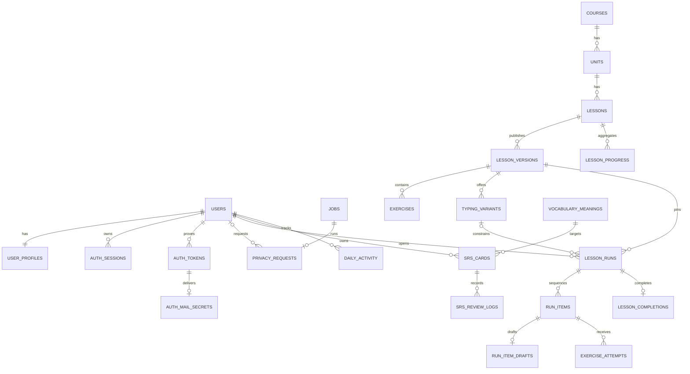
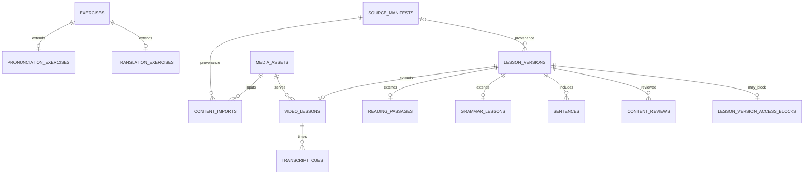
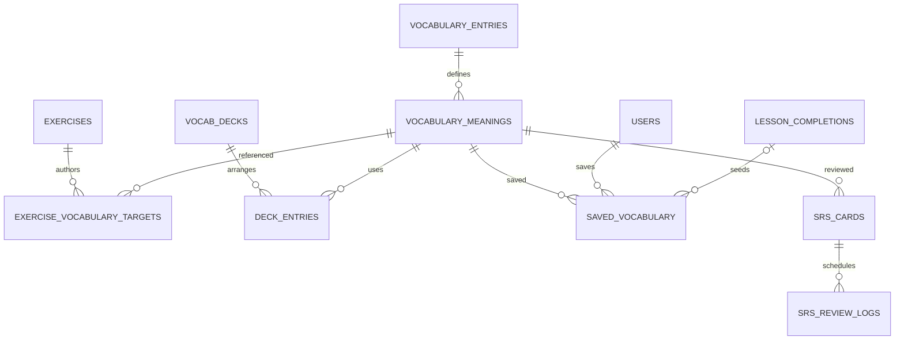
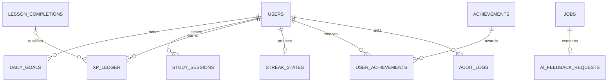

# Thiết kế PostgreSQL

**PROPOSED.** Cơ sở dữ liệu sản phẩm mới. Bảng dưới nêu cột và ràng buộc cần làm migration theo giai đoạn. PostgreSQL giữ lịch sử, trạng thái phiên, xuất bản, lịch ôn và các số đếm authoritative. Xem [API](05-api-specification.md) và [schema nội dung](../data/01-content-schemas.md).

## Quy ước

- `uuid` sinh tại app hoặc DB; `ts` = `timestamptz`; `int` = integer; `str` = text có bound ở Pydantic khi có; `json` = jsonb; `date` = ngày lịch. ID và cột nghiệp vụ bắt buộc `NOT NULL`, trừ cột ký hiệu `?` hoặc được mô tả tùy chọn. PK tạo unique index. UQ = unique constraint/index; IDX = secondary index. Index các FK join quan trọng. `pct` = numeric(5,2) có 0–100.
- Các cột kiểm toán mặc định `created_at ts` cho hàng mới, `updated_at ts` cho hàng mutable. Dùng constraint `CHECK` hoặc enum tên ở từng schema. Mặc định FK `ON DELETE RESTRICT`; phụ thuộc ephemeral có thể cascade qua workflow xóa tài khoản được phê duyệt. Archive/unpublish bằng trạng thái.
- `lesson_id` là identity ổn định, `lesson_version_id` là snapshot. Mọi con thể thuộc version; những chỗ khóa theo run và item version dùng composite FK hoặc constraint trigger được test, không tham chiếu chéo bởi payload JSON.
- JSON chỉ cho union theo `kind`, snapshot receipt, rubric, trace tối thiểu và dữ liệu nhập thô ngắn hạn; validate JSON schema trước commit, constraint loại object/array/size ở DB cho điểm nhạy cảm. Chỉ cho phép block được định kiểu, không đưa HTML thô vào DOM.
- Thời điểm UTC; local activity date tính bằng server từ timezone IANA tại sự kiện và lưu luôn `timezone`. Các ledger và attempts append-only trong thao tác nghiệp vụ. Quy trình xóa/ẩn danh có transaction, quyền riêng và audit.
- Giai đoạn MVP ưu tiên identity, curriculum, typing, CMS, progress và vocab/SRS. Migrate schema V1/V2 khi feature vào sprint; riêng idempotency, audit, jobs và media dùng khi chức năng tương ứng ra mắt.
- PostgreSQL hỗ trợ `NULLS NOT DISTINCT` trong unique index. Dùng đặc tính này cho khóa run có difficulty nullable và kiểm trên PostgreSQL thật.

## Identity, quyền và tùy chọn

| Bảng / mục đích | Cột, PK, FK và constraint | Index, lifecycle và quy tắc |
| --- | --- | --- |
| `users` · định danh | `id uuid PK`, `email str`, `email_norm str`, `password_hash str?`, `status str` pending/active/deactivated, `verified_at ts?`, `deleted_at ts?` | UQ email_norm; canonicalization không giả định dấu chấm/Gmail alias. CHECK pending ⇒ hash/verified_at null; active ⇒ hash/verified_at present. Register/resend tuyệt đối không cập nhật credential hiện có; verify set hash/verified_at khi pending trong cùng txn. Deactivate thu hồi session. Erasure dùng workflow. |
| `user_profiles` · hiển thị | `user_id uuid PK FK users`, `display_name str`, `avatar_asset_id uuid? FK media_assets`, `bio str?`, `public_handle str?` | Một hồ sơ/user; UQ public_handle partial khi có, handle chuẩn hóa lowercase, chỉ tra exact và khi opt-in. Update trường allowlist, không ghi email vào UX social. |
| `learning_preferences` · cá nhân hóa | `user_id uuid PK FK users`, `locale str` mặc định vi, `timezone str`, `current_cefr str`, `target_kind str?`, `target_code str?`, `exam_date date?`, `default_accent str`, `ai_opt_in boolean`, `social_opt_in boolean`, `onboarding_completed_at ts?`, `revision int` | CEFR A1–C2, locale vi/en, accent uk/us/system, IANA qua validation, revision CAS. Chuyển lịch timezone áp dụng từ sự kiện mới. |
| `user_roles` · RBAC | `user_id uuid FK users`, `role str`, `granted_by uuid? FK users`, `granted_at ts`; PK user_id,role | Role learner/editor/reviewer/admin; role grant/revoke audit; IDX role,user_id. |
| `auth_sessions` · phiên opaque | `id uuid PK`, `user_id uuid FK users`, `token_digest bytea`, `expires_at ts`, `last_seen_at ts`, `reauthenticated_at ts?`, `revoked_at ts?` | UQ token_digest; IDX user_id/revoked_at, expires_at. Không lưu cookie token rõ. Step-up 10 phút theo reauthenticated_at, chỉ áp dụng đúng session. TTL + retire job. |
| `auth_tokens` · verify/reset | `id uuid PK`, `user_id uuid FK users`, `purpose str`, `token_digest bytea`, `expires_at ts`, `consumed_at ts?`, `superseded_at ts?` | UQ token_digest; UQ partial user_id,purpose khi consumed/superseded null. Lock user trước token, retire proof trước lúc phát mới. Drop token hết hạn theo retention. |
| `auth_mail_secrets` · delivery payload | `job_id uuid PK FK jobs`, `user_id uuid FK users`, `token_id uuid FK auth_tokens`, `purpose str`, `token_ciphertext bytea`, `nonce bytea`, `kms_key_id str`, `expires_at ts` | UQ token_id; IDX expires_at. Insert khi phát token + job trong một txn; AEAD context user/token/purpose/expiry. Xóa row sau gửi, supersede hoặc expiry; worker chỉ decrypt proof mới nhất hợp lệ. |
| `privacy_requests` · quyền dữ liệu | `job_id uuid PK FK jobs`, `user_id uuid? FK users`, `kind str`, `status str`, `export_asset_id uuid? FK media_assets`, `requested_at ts`, `finished_at ts?`, `export_expires_at ts?`, `error_code str?` | IDX user_id,requested_at và export_expires_at; unique partial user_id,kind cho queued/running. Owner bắt buộc khi tạo; tra theo owner/session. Worker revoke sessions khi bắt đầu erase, job steps retry idempotent, ẩn danh owner sau erase theo retention. Asset riêng và TTL cho export, status không có nội dung xuất. |

## Curriculum, nội dung và CMS

| Bảng / mục đích | Cột, PK, FK và constraint | Index, lifecycle và quy tắc |
| --- | --- | --- |
| `courses` · chương trình | `id uuid PK`, `slug str`, `title str`, `cefr str`, `sort_order int`, `published_at ts?`, `archived_at ts?` | UQ slug; IDX cefr,sort_order; learner chỉ thấy active/published; đổi taxonomy có audit. |
| `units` · chương/trạm | `id uuid PK`, `course_id uuid FK courses`, `slug str`, `title str`, `position int` >0 | UQ course_id,slug và course_id,position; sắp thứ tự có txn. |
| `lessons` · identity | `id uuid PK`, `unit_id uuid FK units`, `slug str`, `kind str`, `position int`, `current_version_id uuid?`, `archived_at ts?` | UQ unit_id,slug và unit_id,position; FK composite (id,current_version_id) → lesson_versions(lesson_id,id); chỉ published được làm current. FK DEFERRABLE cho publish pointer swap; nguồn publish có manifest. |
| `lesson_prerequisites` · yêu cầu trước | `lesson_id uuid FK lessons`, `requires_lesson_id uuid FK lessons`, `policy str` recommended/required; PK lesson_id,requires_lesson_id | Check IDs khác; prerequisite cùng course; validate DAG khi submit và publish dưới advisory lock theo course để chặn chu kỳ do hai người sửa đồng thời; UX nói rõ mở khóa. MVP mặc định recommended. |
| `lesson_versions` · snapshot | `id uuid PK`, `lesson_id uuid FK lessons`, `version_no int`, `status str`, `title str`, `cefr str`, `schema_version int`, `estimated_seconds int?`, `learning_objective str`, `content_checksum str`, `source_manifest_id uuid? FK source_manifests`, `author_id uuid FK users`, `published_by uuid? FK users`, `published_at ts?`, `revision int` | UQ lesson_id,version_no và lesson_id,id; IDX status,updated_at. State draft→in_review→approved→published, reject→draft; published immutable. Archive chỉ ở `lessons` hoặc access override; age-based retention draft. |
| `lesson_version_access_blocks` · thu hồi quyền | `lesson_version_id uuid PK FK lesson_versions`, `blocked_by uuid FK users`, `reason_code str`, `blocked_at ts` | Pivot access quyền/an toàn; block filter cho catalog, run payload và asset URLs. Giữ version/lịch sử và ID không đổi; event thu hồi audit bắt buộc. |
| `content_reviews` · duyệt editorial | `id uuid PK`, `lesson_version_id uuid FK lesson_versions`, `reviewer_id uuid FK users`, `decision str`, `notes str?`, `reviewed_revision int` | IDX version,created_at; actor khác author; append-only. Approval gắn revision, sửa lại cần duyệt mới. |
| `source_manifests` · provenance bất biến | `id uuid PK`, `package_key str`, `source_release str`, `evidence_uri str?`, `manifest_sha256 str`, `records json`, `approved_by uuid? FK users`, `approved_at ts?` | UQ package_key,source_release; records gồm source_key/license/attribution/rights hoặc tác giả nội bộ. Hash canonical của manifest và checksum file import kiểm độc lập đúng release; không update evidence sau approval, tạo release mới. |
| `content_imports` · import CSV/JSON | `id uuid PK`, `requester_id uuid FK users`, `asset_id uuid FK media_assets`, `schema_version int`, `package_key str`, `source_release str`, `file_sha256 str`, `source_manifest_id uuid FK source_manifests`, `state str`, `report json`, `applied_at ts?` | UQ package_key,source_release; cùng SHA-256 trả import cũ, khác SHA-256 conflict. IDX state,created_at; lock import khi apply; row issues với row/field/code; staging expires; dữ liệu draft, publish qua review riêng. |
| `exercises` · trình tự và policy | `id uuid PK`, `lesson_version_id uuid FK lesson_versions`, `position int`, `kind str`, `prompt json`, `grader_config json`, `sentence_id uuid? FK sentences`, `required boolean` | UQ version,position và version,id. Exercise kind dạng discriminated union; grader_config server-only. FK composite bắt cùng version nếu dùng sentence. |
| `sentences` · từ/cụm/câu | `id uuid PK`, `lesson_version_id uuid FK lesson_versions`, `part_kind str` word/phrase/sentence, `english str`, `vietnamese str?`, `ipa str?`, `audio_asset_id uuid? FK media_assets` | UQ version,id; IDX version,part_kind; thẻ audio chỉ từ asset ready; dùng ID ổn định trong version để nối bài. |
| `typing_variants` · lane mở theo phiên bản | `lesson_version_id uuid FK lesson_versions`, `mode str`, `difficulty str`; PK version,mode,difficulty | CHECK default × basic/intermediate/advanced, listen × advanced, listen_speak × advanced. CMS xác nhận candidate sequence không rỗng theo [Engine](06-exercise-engines.md) và asset sẵn sàng; chuyển phase là gate ứng dụng. Giữ bất biến khi publish. |
| `exercise_vocabulary_targets` · nghĩa được biên soạn cho từng prompt | `exercise_id uuid FK exercises`, `meaning_id uuid FK vocabulary_meanings`; PK exercise_id,meaning_id | FK giữ identity của nghĩa; dữ liệu kế thừa snapshot của exercise. Chỉ target được tác giả/CMS duyệt. Không suy ra từ token hoặc kết quả tự nhập; meaning archive vẫn giữ identity cho lịch sử. |
| `grammar_lessons` · lý thuyết | `lesson_version_id uuid PK FK lesson_versions`, `topic_key str`, `blocks json` | IDX topic_key; blocks (rule, note, example vi/en, worked_steps); 1/version, luyện dùng exercises riêng. |
| `reading_passages` · bài đọc | `lesson_version_id uuid PK FK lesson_versions`, `source_lang str`, `paragraphs json`, `translation_lang str?`, `source_attribution str` | Các block có id/position và tùy chọn bản dịch, lookup từ dựa trên entry link, không chép nguồn trái phép; một snapshot/version. |
| `translation_exercises` · rubric | `exercise_id uuid PK FK exercises`, `source_lang str`, `target_lang str`, `source_text str`, `reference_answers json`, `rubric json` | Validate mỗi segment của bài có ít nhất một reference và ngôn ngữ khác nhau; với câu đơn dùng một segment cố định; private cho đến reveal. |
| `video_lessons` · media/video | `lesson_version_id uuid PK FK lesson_versions`, `video_asset_id uuid FK media_assets`, `duration_ms int` >0, `source_url str?`, `attribution str` | IDX video_asset_id; duration của video đã validate; track sync theo cùng timebase. |
| `transcript_cues` · câu theo thời gian | `id uuid PK`, `lesson_version_id uuid FK video_lessons`, `track_lang str`, `position int`, `start_ms int`, `end_ms int`, `text str`, `pair_key str?` | UQ version,lang,position; IDX version,lang,start_ms; 0≤start<end≤duration, không overlap trong cùng track khi publish; lang track có thể thiếu, UI fallback. |
| `pronunciation_exercises` · IPA/shadowing | `exercise_id uuid PK FK exercises`, `target_ipa str?`, `target_text str`, `accent str?`, `reference_asset_id uuid FK media_assets`, `cue_id uuid? FK transcript_cues` | IDX asset; luyện chay V1, ghi âm/AI theo opt-in; cue và target phải thuộc snapshot được pin. |
| `media_assets` · vật liệu | `id uuid PK`, `owner_user_id uuid? FK users`, `storage_key str`, `sha256 str`, `mime_type str`, `byte_size bigint`>0, `duration_ms int?`, `status str`, `purpose str`, `license_key str?`, `attribution str?`, `source_manifest_id uuid? FK source_manifests`, `expires_at ts?` | UQ storage_key; IDX status,created_at và owner_user_id,expires_at. Pending→validated→ready / rejected / revoked. Published immutable, require approved manifest cho tài sản xuất bản, private playback auth. Cleanup staging/recording theo TTL. |

## Học tập và tiến độ

| Bảng / mục đích | Cột, PK, FK và constraint | Index, lifecycle và quy tắc |
| --- | --- | --- |
| `lesson_runs` · phiên học | `id uuid PK`, `user_id uuid FK users`, `lesson_id uuid FK lessons`, `lesson_version_id uuid FK lesson_versions`, `mode str`, `difficulty str?`, `status str` active/completed/abandoned, `cursor int`, `revision int`, `started_at ts`, `ended_at ts?` | FK composite version thuộc lesson. Difficulty khác null đúng khi lesson là typing, kiểm bằng constraint trigger; FK (version,mode,difficulty) đến typing_variants áp dụng khi có difficulty. Unique index partial `NULLS NOT DISTINCT` trên (user_id,lesson_id,lesson_version_id,mode,difficulty) WHERE status='active'. IDX user_id,status,updated_at DESC và user_id,lesson_id,lesson_version_id,mode,difficulty,ended_at DESC. Pin cả hai trục; không đổi lane trong run. |
| `run_items` · trình tự đã chọn | `id uuid PK`, `run_id uuid FK lesson_runs`, `exercise_id uuid FK exercises`, `ordinal int`, `required boolean`, `graded boolean`, `status str`, `attempt_count int`, `hint_count int`, `assisted_at ts?`, `best_score pct?`, `terminal_at ts?` | UQ run_id,ordinal và run_id,id; IDX exercise_id. Trạng thái pending/passed/failed_terminal/revealed/self_ack/skipped theo policy; typing graded required dùng passed/revealed và speech required dùng self_ack. Thứ tự, required và graded bất biến; exercise phải cùng version và đúng lane. Nudge/reveal đặt assisted_at một lần, còn replay giữ kết quả gốc. |
| `run_item_drafts` · nháp dịch | `run_item_id uuid PK FK run_items`, `answer json`, `revision int`, `expires_at ts` | IDX expires_at; chỉ owner qua run, bounded data, CAS revision độc lập với run. Dọn khi terminal/complete hoặc hết TTL; không đưa raw draft vào telemetry. |
| `exercise_attempts` · lịch sử nộp | `id uuid PK`, `run_id uuid`, `run_item_id uuid`, `attempt_no int`, `response json`, `grade json`, `score pct?`, `passed boolean?`, `outcome str`, `assisted boolean`, `grading_version str`, `submitted_at ts`, `duration_ms int?` | FK run_id,run_item_id → run_items; UQ run_item_id,attempt_no; IDX run_id,submitted_at. Cờ assisted là snapshot tại thời điểm nộp, giữ lần đầu bất biến. Hints/reveal đổi item và revision; không tạo attempt giả. Nullable score/pass cho needs_review hoặc unscored; PII purge policy. |
| `lesson_completions` · receipt | `run_id uuid PK FK lesson_runs`, `score pct?`, `assisted_count int`, `typing_metrics json?`, `xp_eligible boolean?`, `xp_delta int?`, `new_saved_count int?`, `progress_snapshot json`, `completed_at ts`, `study_date date`, `timezone str` | Một mỗi run. Với typing giữ snapshot typed về required, graded, first-attempt correct, passed, revealed, acknowledged, mastery. Với speech các trường điểm/mastery null. `xp_delta` 0/10 ở typing, `new_saved_count` ≥0 khi đã bật tích hợp. Snapshot ổn định sau backfill, IDX study_date,completed_at và completed_at,run_id. |
| `lesson_progress` · latest/best | `user_id uuid FK users`, `lesson_id uuid FK lessons`, `last_run_id uuid? FK lesson_runs`, `last_completed_at ts?`, `first_completed_at ts?`, `best_score pct?`, `completed_runs int`; PK user_id,lesson_id | IDX user_id,last_completed_at DESC. Một identity lesson cho yêu cầu trước và số bài; completed_runs là số receipt distinct, kể cả học lại. Best của lane/version tính từ chính các completion cùng tuple, không dùng aggregate này để xếp mastery. Upsert cùng completion, last run cùng owner/lesson. |
| `study_sessions` · thời gian | `id uuid PK`, `user_id uuid FK users`, `run_id uuid? FK lesson_runs`, `started_at ts`, `last_signal_at ts`, `ended_at ts?`, `trusted_active_seconds int` ≥0 | IDX user_id,started_at; UQ user_id partial WHERE ended_at IS NULL; bounded interval qua heartbeat, idle cut-off, split ngày/midnight; expire khi bỏ dở. |
| `daily_goals` · mục tiêu theo hiệu lực | `id uuid PK`, `user_id uuid FK users`, `effective_local_date date`, `minutes int` 5–180 | UQ user_id,effective_local_date; thay hôm nay chỉ khi chính sách cho phép, recommendation chạy lại; giữ history. |
| `daily_activity` · snapshot tổng ngày | `user_id uuid FK users`, `study_date date`, `timezone str`, `active_seconds int`, `completed_lessons int`, `reviewed_cards int`, `earned_xp int`; PK user_id,study_date | Số đếm ≥0. Dưới cùng khóa lesson_progress, kiểm receipt trước đó cùng learner/lesson/ngày rồi chỉ tăng completed_lessons khi chưa có. Daily earned_xp chỉ tăng theo grant vừa insert. Giữ timezone snapshot đầu ngày; thời gian có thể cập nhật riêng với idempotency. |
| `idempotency_records` · command replay | `user_id uuid FK users`, `operation_id str`, `idem_key str`, `body_hash bytea`, `response_status int`, `response_body json`, `expires_at ts`; PK user_id,operation_id,idem_key | IDX expires_at; reservation + mutation + receipt 1 transaction; 409 khác hash; TTL ≥7 ngày. Reply quyền sở hữu recheck. |
| `xp_ledger` · reward MVP | `id uuid PK`, `user_id uuid FK users`, `source_type str`, `source_id uuid`, `source_run_id uuid? FK lesson_completions(run_id)`, `amount int`, `event_time ts`, `study_date date` | UQ user_id,source_type,source_id; IDX user_id,event_time. MVP chỉ insert +10 cho typing_first_eligible_completion với source_id = lesson_id và source_run_id = run thắng cùng owner/lesson. FK source_run_id deferred để ghi receipt bất biến sau grant trong cùng transaction. Cùng user/lesson có một grant qua các lane/version. V2 có thể thêm source và correction riêng. |
| `streak_states` · projection (V2) | `user_id uuid PK FK users`, `last_qualified_date date?`, `current_days int`, `longest_days int` | longest≥current≥0; authoritative qualifying dates từ daily_activity; projection rebuild được. |
| `achievements` · badge cỡ nhỏ (V2) | `id uuid PK`, `code str`, `title str`, `rule json`, `enabled boolean` | UQ code; typed rule version; audit thay đổi. |
| `user_achievements` · đạt badge (V2) | `user_id uuid FK users`, `achievement_id uuid FK achievements`, `earned_at ts`; PK user_id,achievement_id | IDX achievement_id; cấp trùng idempotent, giữ ngày đầu. |

## Vocabulary, dictionary và ôn

| Bảng / mục đích | Cột, PK, FK và constraint | Index, lifecycle và quy tắc |
| --- | --- | --- |
| `vocabulary_entries` · mục từ | `id uuid PK`, `lemma str`, `normalized_lemma str`, `locale str`, `pos str`, `ipa_uk str?`, `ipa_us str?`, `audio_uk_id uuid? FK media_assets`, `audio_us_id uuid? FK media_assets`, `source_ref str`, `license_key str`, `status str` | UQ locale,normalized_lemma,pos; IDX normalized_lemma text_pattern_ops; optional pg_trgm sau benchmark. Dictionary search chỉ published. |
| `vocabulary_meanings` · sense và ví dụ | `id uuid PK`, `entry_id uuid FK vocabulary_entries`, `sense_key str`, `position int`, `definition_en str?`, `gloss_vi str`, `examples json`, `cefr str?`, `archived_at ts?` | UQ entry_id,sense_key và entry_id,position. Sense khả dụng khi entry published, còn quyền và archived_at null. Chỉnh sửa biên tập cùng provenance, archive giữ FK và lịch sử. |
| `vocab_decks` · taxonomy hoặc nhóm riêng | `id uuid PK`, `owner_user_id uuid? FK users`, `slug str`, `title str`, `scope str`, `cefr str?`, `tag str?`, `status str` | UQ public slug partial, UQ owner,slug khi owner present; IDX scope,cefr; owner private, content editor quản public. |
| `deck_entries` · thành viên | `deck_id uuid FK vocab_decks`, `meaning_id uuid FK vocabulary_meanings`, `position int`; PK deck_id,meaning_id | UQ deck_id,position; IDX meaning_id; chia sẻ cùng sense giữa deck, không sinh card trùng. |
| `saved_vocabulary` · lưu cá nhân | `user_id uuid FK users`, `meaning_id uuid FK vocabulary_meanings`, `saved_at ts`, `source str` manual/typing, `source_run_id uuid? FK lesson_completions(run_id)`, `removed_at ts?`; PK user_id,meaning_id | IDX partial user_id,saved_at DESC,meaning_id WHERE removed_at IS NULL. Auto-save chỉ insert missing row theo meaning_id tăng dần, giữ metadata manual và tombstone, source_run_id thuộc owner. FK source_run_id deferred. Explicit save xóa tombstone, explicit remove đặt removed_at, cả hai riêng thẻ SRS. |
| `srs_cards` · lịch ôn hiện có | `id uuid PK`, `user_id uuid FK users`, `meaning_id uuid FK vocabulary_meanings`, `direction str` en_vi/vi_en, `state str` new/learning/review/suspended, `due_at ts`, `repetitions int`, `interval_days int`, `ease numeric(4,2)`, `revision int`, `algorithm_version str` | UQ user_id,meaning_id,direction; IDX partial user_id,due_at,id where state<>'suspended'; row locked khi review. Ease ≥1.30; retry với revision và idem. |
| `srs_review_logs` · lịch sử | `id uuid PK`, `card_id uuid FK srs_cards`, `card_revision_before int`, `rating str`, `reviewed_at ts`, `due_before ts`, `due_after ts`, `before_state json`, `after_state json`, `algorithm_version str` | UQ card_id,card_revision_before; IDX card_id,reviewed_at; append-only, không backfill số liệu thật từ client clock. |

## Tích hợp, trợ giúp và quản trị

| Bảng / mục đích | Cột, PK, FK và constraint | Index, lifecycle và quy tắc |
| --- | --- | --- |
| `outbox_events` · durable event | `id uuid PK`, `event_type str`, `source_id uuid`, `event_key str`, `payload json`, `processed_at ts?`, `available_at ts` | UQ event_key; IDX available_at,id partial unprocessed; giữ event tối thiểu, kèm payload_version; dọn sau retention. |
| `jobs` · worker | `id uuid PK`, `kind str`, `dedupe_key str`, `status str`, `attempts int`, `payload json`, `available_at ts`, `lease_until ts?`, `lease_owner str?`, `last_error_code str?` | UQ kind,dedupe_key; IDX status,available_at và lease_until; retry bounded, no secrets/PII raw. |
| `ai_feedback_requests` · async result (V2) | `id uuid PK`, `user_id uuid FK users`, `attempt_id uuid? FK exercise_attempts`, `asset_id uuid? FK media_assets`, `job_id uuid FK jobs`, `kind str`, `rubric_version str`, `prompt_version str`, `provider_name str?`, `model_name str?`, `status str`, `result json?`, `usage_units int?`, `expires_at ts` | UQ job_id; IDX user_id,created_at và expires_at; requires owned reference, opt-in và quota; xóa recording/result theo TTL; AI không ghi đè điểm. |
| `ai_usage_daily` · budget (V2) | `user_id uuid FK users`, `quota_date date`, `reserved_units int`, `used_units int`; PK user_id,quota_date | Atomic reserve/settle và release khi fail; provider quotas và global spend gate thêm ngoài DB. |
| `support_feedback` · yêu cầu | `id uuid PK`, `user_id uuid? FK users`, `category str`, `message str`, `lesson_version_id uuid? FK lesson_versions`, `run_item_id uuid? FK run_items`, `status str`, `assignee_id uuid? FK users`, `revision int` | IDX status,created_at; text size bound, reference ownership và version match, chống spam, staff triage có audit và retention theo privacy. |
| `friendships` · social (tùy chọn) | `low_user_id uuid FK users`, `high_user_id uuid FK users`, `requested_by uuid FK users`, `blocked_by uuid? FK users`, `status str`, `updated_at ts`; PK low_user_id,high_user_id | low<high, requested_by thuộc cặp. IDX high_user_id,status; chỉ cặp được đọc. Status pending/accepted/declined/disconnected/blocked, blocker thuộc cặp. Report và moderation sẵn sàng trước release. |
| `audit_logs` · sự kiện bảo mật/biên tập | `id uuid PK`, `actor_user_id uuid? FK users`, `operation str`, `target_kind str`, `target_id uuid?`, `result str`, `request_id uuid`, `safe_changes json?`, `created_at ts` | IDX target_kind,target_id,created_at và actor_user_id,created_at; append-only, quyền support giới hạn, không log token/input cá nhân. |

## ERD tổng thể

## ERD theo module

## Migration và chứng minh tính nhất quán

1. Dựng schema theo identity → media/catalog và từ vựng biên tập → curriculum/editorial → learning/progress/XP → kho từ/SRS → V1/V2. Sprint 02 tạo identity nghĩa cho target biên tập. Sprint 03 tạo run theo variant và ledger XP. Sprint 05 thêm kho cá nhân và SRS. Sử dụng migration hai giai đoạn cho FK vòng giữa lesson + current version hoặc user profile + media.
2. Publish: lock lesson, validate version được duyệt và checksum, kiểm asset ready/prerequisite DAG, cập nhật published + pointer + audit/outbox trong một transaction. Truy vấn learner lọc `published` và rescope đúng version. Từ chối cross-version và xóa version còn reference.
3. Lệnh đồng thời same-key replay, khác payload conflict. Đồng thời với khác key kiểm revision, khóa hàng và unique constraints. Bài đang chạy vẫn chấm đúng snapshot sau publish bản mới. Test hai phiên DB độc lập.
4. Để migrate khi đang chạy, expand schema và backing index, deploy code tương thích cả hai, backfill theo batch và kiểm số dòng, rồi contract sau một release. Duy trì bản restore staging và kiểm thử WAL/PITR trước production. Đổi engine ghi `grading_version` hoặc `algorithm_version` và giữ lịch sử trước đây.
5. Sprint 05 tạo saved_vocabulary trước, drain các giao dịch completion đang xử lý, chốt phạm vi completion đã commit và dựng kho từ theo (completed_at,run_id) trong từng batch. Với mỗi candidate, giữ mục đầu tiên còn khả dụng theo thứ tự này, dùng ngày completion làm saved_at và `ON CONFLICT DO NOTHING`. Checkpoint đi cùng transaction của batch. Chạy trước khi mở auto-save và enroll cho learner; endpoint complete trả 503 kèm Retry-After trong cửa sổ cutover đã đo, giữ nguyên run để phục hồi. Bật insert realtime và gỡ gate sau đối soát. Backfill chỉ tác động kho từ, giữ receipt, XP, progress, thẻ và lịch ôn.

