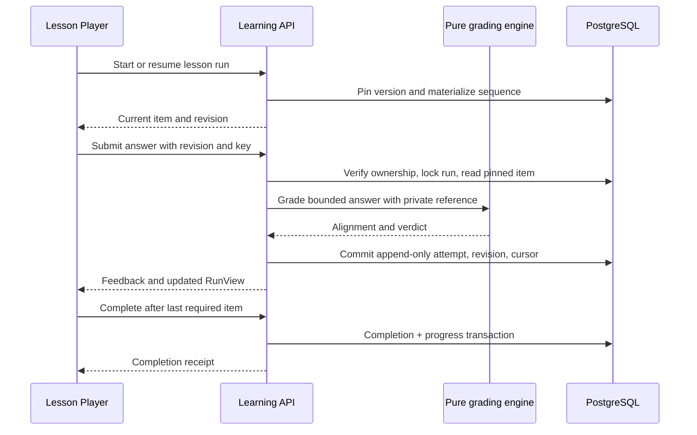
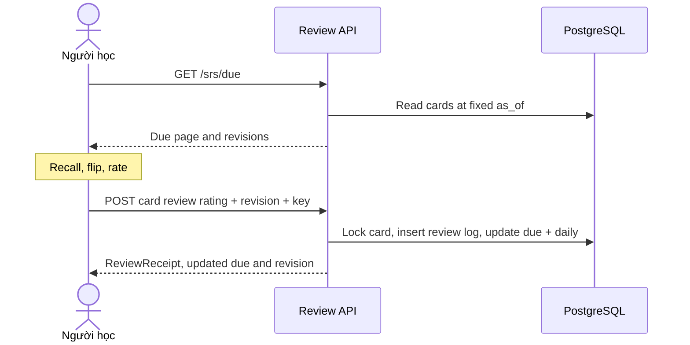

# Đặc tả bộ máy bài tập

**PROPOSED.** Các chính sách dưới đây là hợp đồng sản phẩm mới. Khảo sát gõ câu và flashcard cho biết các hành vi mà người học nhìn thấy; thuật toán gốc của AIO English chưa được xác minh. Xem [SRS](../requirements/02-SRS.md), [run API](05-api-specification.md) và [test cases](../testing/02-test-cases.md).

## Nền tảng dùng chung

`ExerciseSpec(version,exercise_id,kind,prompt,policy,private_grader_config)` được pin bằng lesson version. `RunItem(item_id,ordinal,revision,counters,status)` nhận đáp án từ learner đang ở cursor. Pure engine nhận revision nội dung, answer DTO và scoring config. Trả `Grade(outcome,passed?,score?,feedback,grading_version)`; `null` cho trường hợp không có điểm xác định. Service giữ ownership, transaction và idempotency; engine không gọi API/DB. Đáp án chuẩn, rubric và secret ở server. Gửi lại có cùng key dùng grade đã lưu, không chấm theo policy mới.



## Typing: FR-TYPE-001

### Chuẩn hóa và token

1. Kiểm JSON sớm. Nhận tối đa 1000 Unicode code point và 128 token. Từ chối control char không phải whitespace được phép (`tab`, newline), Unicode bidi control và zero-width formatting. Prompt kỳ vọng không rỗng, phải qua validate CMS trước publish. Dùng Unicode NFC, chuẩn hóa U+2018/U+2019 thành apostrophe thẳng và U+2010/U+2011 thành hyphen `-`; English lowercasing, không lệ thuộc locale máy người dùng. Collapse whitespace Unicode thành dấu cách, trim.
2. Token là chuỗi Unicode letter/mark/digit có apostrophe/hyphen khi chúng nằm giữa hai đoạn token. Dấu câu ngoài token là separator. Vì vậy `Wait, now!` và `wait now` tương đương; `don't` khác `dont`, `re-enter` khác `re enter`, `12.5` thành `12` và `5` trong mode này. Decimal/định dạng số và dấu có nghĩa đặc biệt cần reference do editor khai báo, hoặc một exercise mode theo format với policy riêng.
3. Giữ cả raw input đã validate và mapping token → span trên input cho màn feedback; normalize một token có thể đổi độ dài và nhiều code point. Index trong response là thứ tự token, không dùng offset byte làm vị trí JS.
4. Các dạng rút gọn, số viết chữ, chính tả UK/US và dấu thanh không tự hợp nhất. Editor thêm reference alternative khi hợp lệ. Dùng cùng normalization trên expected và actual. Answer chỉ dấu câu/whitespace → 422 và không tạo attempt. Từ chối input vượt giới hạn ngay tại validation.

### Căn chỉnh và điểm

- Levenshtein trên token: match cost 0; substitute, delete expected (missing), insert actual (extra) cost 1. Dynamic programming với traceback từ cuối, tie priority theo hướng traceback `match → substitute → missing → extra`. Ma trận `(n+1)*(m+1)` với cap 128 để thời gian/bộ nhớ O(nm), ổn định cả lặp token. Thứ tự kết quả sau reverse là theo chuỗi.
- Chạy từng reference (tối đa 10), chọn distance nhỏ nhất rồi reference theo thứ tự biên soạn. Alignment ops `match/wrong/missing/extra` chứa index expected/actual phù hợp. UI dùng chữ/ký hiệu và màu cùng lúc. Không trả `expected_token` cho wrong/missing trước reveal; nêu vị trí và loại lỗi. Các token learner đã gõ an toàn để echo dưới dạng plain text. `passed` nếu distance=0; `score=round_half_up(100 × max(0,1-distance/max(n,m,1)),2)`.
- Thành công hoàn toàn đưa item vào passed và advance cursor; UI giữ feedback tới khi chọn Tiếp tục, rồi render current item đã được server xác nhận. Sai để nguyên item, hiện lý do, cho retry. Submits trùng được ràng buộc theo request key/revision theo API. Kể cả mới thay key, một revision/cursor cũ không tạo điểm kép.
- Nudge tối đa một lần/item khi mode cho phép; editor cung cấp chiều dài, mẹo hoặc ngữ cảnh, không trích đáp án đầy đủ. Reveal xuất hiện khi có tối thiểu 2 lần thử hợp lệ sai; terminal `revealed` ở chế độ luyện và `assisted=true`. Đề kiểm tra tắt hint/reveal và kết thúc item sau lần thử hợp lệ đầu tiên, lưu kết quả pass/fail. Limit tần suất + cap bảo vệ tài nguyên.
- Chỉ cần tất cả required items terminal để hoàn tất; report số đúng độc lập, assisted, tỷ lệ đúng lần đầu và điểm theo mode. Điểm bài typing MVP lấy trung bình điểm terminal: pass 100, revealed 0, chế độ kiểm tra lấy điểm attempt, item optional không đổi mẫu số. Translation/IPA self-practice với toàn bộ kết quả unscored trả điểm null; mẫu số analytics loại trừ item không tính điểm. Một lần hoàn thành được tạo theo run, replay phải trả cùng result. XP V2 lấy lần hoàn thành đầu của lesson đủ điều kiện làm nguồn thưởng. Replay, hoàn thành lại hoặc hai run cùng lesson cạnh tranh đều có tối đa một grant theo nguồn.

```text
grade_typing(raw, references):
  actual = normalize_and_tokenize_validated(raw)
  require 1 <= len(actual) <= 128
  candidates = [(distance_and_trace(expected, actual), order)
                for each approved reference in author order]
  align, selected = choose by (distance, author order)
  score = round_half_up(max(0, 100 * (1 - distance / max(lengths, 1))), 2)
  passed = distance == 0
  return redact_as_needed(grade(passed, score, align, grading_version))

submit(run, cmd, key):
  in one transaction:
    replay or reserve key
    lock run and validate owner/state/revision/current_item
    grade using run's published immutable version
    append attempt; apply mode terminal/retry policy and increment revision
    write receipt
  return receipt
```

| Test | Input với reference “I carry a small bag.” nếu không ghi khác | Kết quả |
| --- | --- | --- |
| ENG-T01 | `i CARRY  a small bag!` | Pass 100, năm match; caps/space/punctuation chuẩn hóa. |
| ENG-T02 | `I carry a red bag.` | 1 wrong, score 80, không gửi `small` trước reveal. |
| ENG-T03 | `I carry small bag` / `I carry a very small bag` | 1 missing, 80 / 1 extra, 83.33. |
| ENG-T04 | whitespace, `...`, IME composition, control chars, > caps | 422 không tạo attempt cho server invalid; IME không tự submit ở UI. |
| ENG-T05 | ref `don't re-enter` và actual `don’t re‑enter` / `dont re enter` | Pass biến thể unicode hợp lệ; mismatch dạng bỏ apostrophe/hyphen. |
| ENG-T06 | reference `a a b`, input `a b` và alt bằng điểm | Trace cố định; author order quyết định alt tie. Traceback implementation được snapshot test. |
| ENG-T07 | Submit accepted rồi timeout, retry same key; đổi body cùng key | Same attempt id, không double; 409 body conflict. |
| ENG-T08 | Hai tabs cùng revision, hint và submit; giới hạn reveal; reload sau pass | Một command chuyển revision, stale 409; không lộ answer trước policy; cursor sau reload theo server. |
| ENG-T09 | Publish mới khi có run; input theo bản cũ | Chấm version đã pin; run mới lấy version mới. |

## Vocabulary và ôn: FR-VOCAB-001, FR-SRS-001

Stock do card sở hữu key `(learner, meaning, direction)` và tách dấu saved. Đề xuất MVP flashcard recall tự chấm để quay lại thường xuyên. Học sâu nhiều dạng bài, AI tạo bộ từ và tự auto-enroll sau bài được ưu tiên sau khi có bằng chứng về giá trị. Deck lồng theo CEFR/tag; mất membership không xóa review logs. Hai chiều prompt là card khác nhau. UI có front, revealed, rating_pending, confirmed, retryable, empty và complete. Space flip và dãy 1–4 chỉ active khi focus phù hợp. Khi no due, hiện học thêm hoặc ngày ôn tiếp; không tự chấm thẻ chưa lật.

### Quy tắc lịch

- SM-2 biến thể dễ giải thích, `algorithm_version=sm2-elp-v1`. State `new/learning/review/suspended`, `repetitions`, `interval_days`, `ease` khởi tạo 2.50, lower bound 1.30, max interval 365 ngày. Map again→0, hard→3, good→4, easy→5.
- Update `ease=round_half_up(max(1.30, oldEase+0.10-(5-q)*(0.08+(5-q)*0.02)),2)`. Again reset reps=0, interval=0, learning, due_at=server UTC now +10 phút, repeat_in_session=true. Ngay sau khi chấm lần nữa server chỉ chấp nhận khi due; mode tự học ngoài SRS có thể luyện lại mà không đổi lịch.
- Với q≥3, reps mới là old+1. Reps=1 → 1 ngày, reps=2 → 6, reps≥3 → max(previous+1, rounded previous*oldEase), cap 365; state review. due_at = now UTC + n×24h, không trượt DST. Trong pilot Hard/Good/Easy đầu cùng khoảng và phân biệt Ease; UI hiển thị dự kiến theo thuật toán thực. Xu hướng ease và retention xem lại sau đủ dữ liệu. SRS không dùng các nhãn phút đo từ website tham khảo.
- Timestamp authoritative lấy từ server. Scheduler thuần có clock injectable. Due query inclusive `due_at<=as_of`. Worker không bắt buộc để query due. Bản ghi cũ giữ algorithm_version khi đổi thuật toán; migration chỉ opt-in trên cohort đã chọn. Revision trước khi chấm duy nhất để nhận race sau TTL idempotency.
- Một phiên kết thúc khi queue đã chọn hết hoặc người học dừng, hiển thị số thẻ đã chấm, lại trong phiên và còn đến hạn; chỉ item đã commit tính số. Không suy luận đã thuộc lâu dài từ một self-rating.



```text
next_review(card, rating, server_now):
  require card is not suspended and due_at <= server_now
  q = {again:0, hard:3, good:4, easy:5}[rating]
  new_ease = clamp_and_round_ease(card.ease, q)
  if q == 0: return learning(reps=0, days=0, ease=new_ease,
                             due=server_now + 10 minutes)
  reps = card.reps + 1
  interval = (1 if reps==1; 6 if reps==2;
              min(365, max(card.interval+1, round_half_up(card.interval*card.ease))) otherwise)
  return review(reps, interval, new_ease, server_now + interval*24h)
```

| Test | Kỳ vọng |
| --- | --- |
| ENG-S01 New + good | Reps=1, ease=2.50, due sau 24h UTC; lần good tiếp sau 6 ngày. |
| ENG-S02 Review + again | Reps=0, interval=0, ease min 1.30, đến hạn +10 phút; cấm early durable chấm. |
| ENG-S03 Hard/easy | Rating cập nhật ease theo công thức và cap; đủ 365 không tăng. |
| ENG-S04 Due boundary | 1 ms trước due bị từ chối; thời điểm bằng due được chấp nhận; UTC qua DST không đổi elapsed. |
| ENG-S05 Duplicate | Retried key nhận same review; key khác trên revision cũ 409; log/daily chỉ một. |
| ENG-S06 Enrollment | Cùng sense ở hai deck không nhân card cùng hướng; hướng khác được tạo. |

## Translation: FR-TRANS-001 và FR-AI-001

- Version giữ `source_lang, target_lang, source_text, references[], rubric_version, rubric`. Reference tác giả chấp thuận có nguồn và rationale ngắn. Rubric đánh giá fidelity/coverage, grammar, naturalness theo 0–4 mỗi chiều; báo lỗi theo `span,category,severity,explanation_vi,suggestion`. Chỉ gán lỗi khi rubric và bằng chứng giải thích được khác biệt về nội dung/ngữ pháp. Với dấu thanh tiếng Việt, NFC + case/whitespace đủ, giữ dấu trong token.
- V1 normalize và exact match qua mọi references đã phê duyệt. Bài nhiều đoạn cho mỗi đoạn nguồn một segment ID; coverage = số required segments có đáp án không rỗng / số required segments. Coverage chỉ đo phần được trả lời, không đo đầy đủ ý. Tất cả phân đoạn đầy đủ và mỗi đoạn match nhận pass; không match thì trả `needs_review` + phản hồi tham chiếu khi learner chọn xem. Alignment có thể hiển thị khác biệt nhưng không quy đồng là lỗi. Missing/unclear không cho điểm sai tự động trong yêu cầu cần dịch tự do. Completion translation practice cho terminal after learner ack bằng reveal; lưu trạng thái assisted/no grade khi không matched. Dùng multiple-choice/rule-based với đáp án xác định riêng nếu cần bài đánh giá.
- V2, opt-in gửi source, answer, rubric và bộ references tối thiểu đến LLM as data. Ràng buộc structured schema, check enum, field length, score và span; nếu output không đúng/thiếu confidence hoặc có ambiguity thì trả `needs_review` với message trung lập. Model không gọi tool hay tiết lộ prompt/secret. Một lần fallback parse/repair nếu rơi trong budget; lỗi provider → manual comparison, không đổi lịch học. Không ghi đè accuracy/proficiency dựa chỉ trên model. Tách evaluation dataset version có chấm người và so sánh giữa phiên bản.
- Input tất cả phân đoạn rỗng, segment trùng/foreign, vượt giới hạn hoặc unsafe Unicode controls: 422. Nháp per run/item dùng revision riêng, có TTL và xóa khi terminal; lịch sử từ attempt theo chiều và snapshot pin. Ví dụ nhãn trạng thái gồm “Accepted reference match”, “Compare with two sample translations”, “AI pending” theo loại. Store original answer encrypted at rest theo hạ tầng, giữ theo retention; logs chỉ grade metadata.
  
```text
assess_translation(answer, version, want_ai):
  normalized, coverage = normalize_answer_by_segment(answer, version)
  if coverage == 1 and each submitted segment matches an approved reference:
    return exact_match_pass()
  feedback = needs_review_with_optional_reference_reveal(coverage)
  if want_ai and consent and allowed_budget:
    enqueue_job_with_pinned_rubric_and_attempt()
  return feedback
```

| Test | Kỳ vọng |
| --- | --- |
| ENG-X01 Exact approved alternative | Pass ngay với khác case/spacing theo quy tắc; không cần provider. |
| ENG-X02 Diễn đạt đúng khác reference | Needs review, giải thích so sánh, không gán sai tuyệt đối. |
| ENG-X06 Dịch hai trong ba đoạn required | Coverage 2/3, needs_review; không tự xem là hai đoạn đúng hoàn toàn. |
| ENG-X03 Từ phủ định/đơn vị/số quan trọng bị thay | Bộ kiểm định có nhãn critical; AI phải làm nổi mâu thuẫn khi trả valid, chưa đủ tin thì human review. |
| ENG-X04 Prompt injection trong user input / model JSON sai | Xử lý như text; validator từ chối output, không có side effects hoặc lời gợi ý nguy hiểm. |
| ENG-X05 Opt-out / expiry / timeout | Không queue nếu opt-out; expired không phục hồi dữ liệu; fallback compare. |

## Grammar, đọc, dictation và phát âm

- Grammar/đọc chọn một: option IDs versioned, required exactly one; khi submit compare server key và giải thích. Rewrite/điền dùng typing policy riêng cho exercise; mark explanation/hint allowed theo lesson mode. Sau khi xuất bản pin blocks/rules.
- Dictation dùng grader typing và expected versioned cue, prompt không expose transcript trước feedback, tốc độ replay quản ngay tại player. Audio lỗi có retry/alternative text tùy mục tiêu, không trừ điểm vì lỗi tải.
- IPA/shadowing V1 dùng model audio có quyền, IPA và loop; learner tự xác nhận practice_ack khi mode cho phép. Speech score V2 chỉ formative, tách voice retention và consent. Không suy từ transcript STT rằng phát âm mọi phoneme sai/đúng.

## Exercise analytics

| Metric | Nguồn, mẫu số và quy tắc |
| --- | --- |
| First-attempt accuracy | Số item pass trên attempt hợp lệ đầu / tổng item có attempt hợp lệ đầu trong cohort. Bỏ no-attempt, không bỏ fail; tách mode/gradable. |
| Attempts per item | Tổng attempts accepted / số item có attempt. Validation, replay và hint không tăng. |
| Completion rate | Distinct completed runs / active runs đã bắt đầu trong window cố định và có follow-up tối thiểu, tách mode. Theo dõi abandon và thời gian theo cohort. |
| Response time | Elapsed giữa item visible/server start và submit, có idle policy, báo p50/p95, client mốc dùng cho analytics allowlisted, không tin dùng cấp điểm. |
| Progress | Distinct lessons đã completion theo version policy / eligible lessons trong published program, last/best không cộng lại idempotent. |
| Recall | Good/easy trong first durable review sau ≥24h / first durable reviewed eligible cards; self-report, tách sample size, state new/learning/review. |
| Quality | Alignment wrong/missing/extra theo nhóm và AI abstention/safety/rubric agreement; không đưa raw answer/audio vào analytics chung. |

Mọi thống kê day/streak dùng local date server. Test một activity đổi timezone giữa ngày, qua midnight, DST và retry. Tách cohort khi đổi grading_version/algorithm_version để kiểm tra hồi quy.

