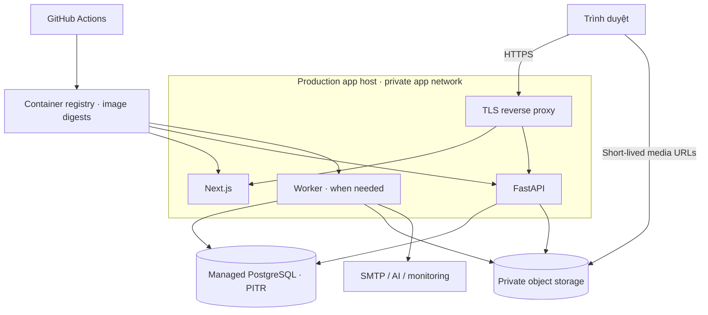
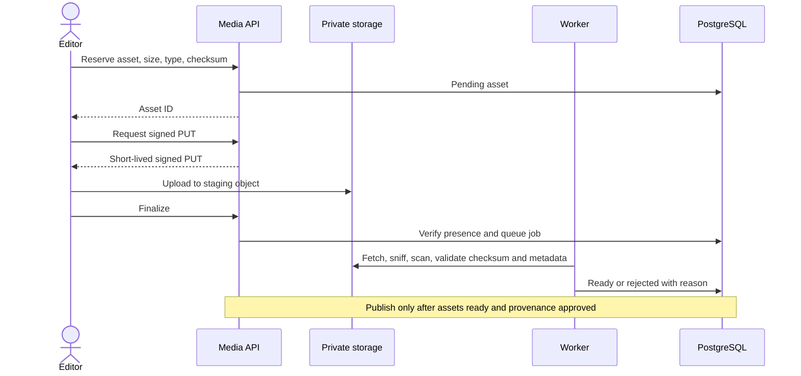
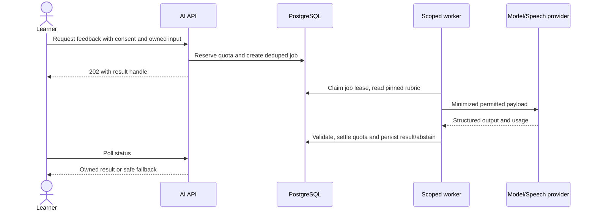

# Kiến trúc triển khai và tích hợp

Sprint 00 chốt nền local và cổng CI. Staging/production là kiến trúc đề xuất, với lựa chọn vùng dữ liệu, nhà cung cấp và ngân sách chờ chủ dự án duyệt. Sprint 12 là gate cho từng bản phát hành. [ADR triển khai](adr/0002-http-and-deployment-baseline.md)

## Deployment

| Môi trường | Thiết kế | Gate |
| --- | --- | --- |
| Local | Compose chạy PostgreSQL 17, job migrate, FastAPI và Web. Job migrate upgrade baseline, API chờ migration và DB healthy, Web chờ API ready. Next chuyển tiếp cùng origin đến `http://api:8000`. Cổng host bind loopback. | Kiểm `/health/live`, `/health/ready`, OpenAPI và browser. `DATABASE_URL` dùng runtime/migration; test DB dùng `TEST_DATABASE_URL` riêng. Xem [hướng dẫn chạy](../../README.md). |
| CI | Sprint 00 cài từ npm/uv lockfile, lint/typecheck/build/test, PostgreSQL sạch, Alembic upgrade/check, schema diff và Playwright. Build, SBOM và publish digest lên registry thuộc pipeline phát hành sau khi duyệt. | CI nền tảng kiểm tại checkout. Secret triển khai chỉ vào job được duyệt, không in env. [ADR công cụ](adr/0001-local-toolchain-and-monorepo.md) |
| Staging | Cùng topology và schema với production, synthetic data, mail sink, provider test. Focus mobile, media, CMS và concurrency. | Smoke + sample restore trước migration rủi ro, baseline load test và note schema version. |
| Production | Một VPS/application host đầu tiên sau TLS và managed Postgres có backup/WAL. Worker cùng Python image nhưng process riêng. Object bucket private và ACL theo mục đích. Tăng số process/horizontal khi quan sát tải. | Health, alert, restore rehearsal, release config, pinned image, backup hợp lệ, rollback owner. Single app host phải cân nhắc nếu availability đo dưới 99.5%. |

Traefik/Caddy/Nginx chọn một theo hosting. DNS/SSL renewal tự động, origin security headers và CSP cho nguồn media cho phép. API/DB ở mạng private; công khai 443, cổng 80 phục vụ redirect/challenge khi cần. DB bắt buộc TLS phía client và user migration tách khỏi runtime. Secrets từ secret manager/host runner, rotation SMTP/API keys và hạn quyền; KMS tách quyền encrypt của API và decrypt của mail worker, giữ key ID theo thời hạn ciphertext; không commit credentials. Mỗi môi trường dùng bucket, DB, issuer và service account riêng. App tách đích API/gateway cho public hostname và lưu policy CORS chặt ở storage; CDN chỉ cache tài sản được phép và có kiểm revoke.

Local/CI dùng bản Alembic metadata dưới `apps/api/alembic/versions/`; migration tạo bảng học tập đi theo sprint tương ứng. `API_INTERNAL_URL` lấy theo build/start. Với CI hoặc native dev, origin API mặc định là `http://127.0.0.1:8000`. Production định tuyến `/api/v1/` và health theo chính sách reverse proxy; readiness không phụ thuộc nhà cung cấp email/AI. Worker và mail sink được thêm khi luồng xác thực cần.

## Release, migration, rollback

1. CI tạo image digest Web/API/worker và migration report; deploy staging theo digest. Chạy Alembic một job singleton với advisory lock, expand schema trước, verify phiên bản app cũ còn đọc. Backfill batch có checkpoint.
2. Prepare production: xác nhận PostgreSQL snapshot/PITR, image rollback, health, log/alert owner. Apply migration additive tương thích; đổi service image theo thứ tự API/worker rồi Web khi schema contract tương thích. Dùng health gate trước chuyển traffic; smoke register email-only qua mail sink tại staging, verify rồi login, resend hết hạn, reauth và export owner-only, curriculum, typing synthetic account được chỉ định, SRS due, CMS publish preview.
3. Nếu readiness hoặc SLO rớt, tắt feature flag ảnh hưởng, rollback image trước trong window tương thích. Không downgrade phá dữ liệu khi vừa có writes. Restore point-in-time chỉ theo incident playbook và quyết định với dữ liệu bị thiếu sau restore; xác nhận FK/pointer/active run/SRS ledger và reconcile media/outbox trước mở lại.
4. Contract migration chỉ sau khi không còn app cũ, backfill đã verify và backup/restore đáp ứng. Publish nội dung có thể chọn lại version đã duyệt bằng quy trình rollback có audit và access policy, run pin giữ nguyên.
5. Sprint 05 dùng cửa sổ cutover đã đo ở staging để drain/pause completion, dựng kho từ lịch sử theo batch checkpoint, xác nhận tombstone và thẻ ôn giữ nguyên rồi bật auto-save trong transaction completion. Khi gate đang active, complete trả 503 và `Retry-After`. [Trình tự dữ liệu](04-database-design.md#migration-và-chứng-minh-tính-nhất-quán)

## Media ingestion

API cấp URL cho bản publish có asset ready. Upload bind size/type/hash và object path riêng; scanner thực hiện ngoài transaction SQL. Kiểm MIME thực, giới hạn bytes/duration/decode, checksum, malware, cue schema/timebase và license/attribution. Object ready dùng final key immutable và metadata trong DB. Cleanup staging có idempotency; nếu DB update fail sau copy thì retry cùng checksum hoặc dọn orphan sau 7 ngày. Revoke dừng cấp URL mới, playback URL mặc định 5 phút; CDN purge khi cần. Test HTTP range, refresh hết hạn, cue boundary và CORS. Audio ghi từ bài nghe và nói/shadowing V1 ở lại thiết bị. Nếu mở upload speech opt-in V2, dùng prefix riêng, cache private, TTL đề xuất tối đa 7 ngày và duyệt retention trước rollout.

## AI/STT/TTS (V2)

Quota theo learner/ngày và cap toàn hệ thống, max tokens/audio seconds, timeout/provider retry theo lỗi. Validate structured output và xử lý như dữ liệu; prompt/learning content không có quyền gọi tool. Gửi ít auth/PII nhất, chỉ provider được duyệt, preference opt-in và audit. Translation fallback compare reference; shadowing fallback playback/reference; chấm cốt lõi không phụ thuộc AI. Hủy queue chưa gửi khi opt-out, xóa dữ liệu theo workflow sở hữu và retention. Trường hợp provider đã nhận nhưng chưa có receipt đưa về trạng thái cần điều tra nếu provider thiếu idempotency. Khi chất lượng hay chi phí vượt ngưỡng, tắt flag theo module, giữ lộ trình học chuẩn.

Gia sư AI là mở rộng sau khi hoàn thành gate feedback. Nếu triển khai, giới hạn phiên và lượt hội thoại theo ngân sách; gắn bối cảnh với lesson đã publish, cho phép xóa lịch sử theo chính sách, lọc nội dung và đánh giá dẫn nguồn trước khi mở cho learner. Lời khuyên của gia sư không thay đổi điểm và tiến độ. Quyết định provider, retention và yêu cầu người dùng nhỏ tuổi chốt ở Sprint 10 trước rollout.

## Vận hành và hiệu năng

- Pilot target 99.5% availability tháng trên luồng xác thực và học chính. RPO ≤15 phút, RTO ≤4 giờ với PITR managed PostgreSQL; restore diễn tập trước mỗi release và sau thay đổi topology. Object versioning và lifecycle; verify mapping DB asset IDs/keys sau restore. Incident owner có sổ chạy và quyền tối thiểu.
- Endpoint read p95 ≤300 ms, typing submit p95 ≤400 ms ở 50 phiên learner đồng thời trên baseline đại diện, trừ latency mạng/browser ngoài metric. First media frame p95 ≤2.5 giây trên cấu hình staging mục tiêu; cue sai lệch ≤250 ms qua seek/rate change trong E2E. Ghi rõ dataset, preload, cache, throttling, pass/fail trước release.
- Metrics p50/p95/p99 + 5xx/429, DB locks/storage, queue age, expired lease, provider spend, publish failure, due queue latency, error correlation ID. Alerts theo SLO, queue lâu hơn ngưỡng và backup failure. Logs JSON scrub IP khi phù hợp, không có payload answer, email/token, signed URLs hoặc audio.
- Backup mã hóa, least privilege, logs/PII retention, access audit. Health/readiness probe qua internal loopback/network. Dùng load test thấy bottleneck trước Redis/CDN/replica. Runbook mô tả degraded media/AI, rollback và restore từng lỗi. Xem [performance và security](../testing/03-performance-and-security.md).

