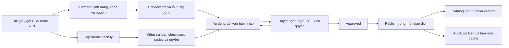

# Pipeline biên soạn, nhập và xuất bản

**PROPOSED** cho FR-CMS-001. CMS chạy trong modular monolith. PostgreSQL là nguồn chuẩn của phiên bản và trạng thái. Object storage lưu tệp gốc cách ly, derivative đã xử lý và tài liệu quyền theo quyền truy cập tương ứng.

## Vai trò và màn hình CMS

| Vai trò | Quyền | Màn hình và kết quả |
|---|---|---|
| Editor | Tạo, nhập và sửa draft, liên kết asset, gửi duyệt. | Danh sách phiên bản, diff so với bản đang công bố, trình preview theo kind và mô phỏng learner. |
| Reviewer | Duyệt nội dung, cấp độ, nguồn, ghi công và quyền của phiên bản được xem. Trả lại draft kèm lý do. | Hàng đợi, checklist ngôn ngữ/quyền, hiển thị tệp lỗi và chênh lệch. |
| Admin | Công bố hoặc thu hồi phiên bản, cấp role, quản lý policy nguồn, giới hạn import và truy cập audit. | Preview điều kiện publish, theo dõi các phiên bản, lịch sử publish/revoke và quản lý quyền. Dùng tài khoản được cấp quyền tối thiểu cho nhiệm vụ. |

Một người có thể giữ nhiều role theo chính sách. Người duyệt và người soạn phiên bản phải khác nhau. API xác minh role khi đọc bản nháp, xem báo cáo, duyệt và xuất bản. Log người xử lý, thời gian, phiên bản và lý do.

## Nhập nội dung

1. Editor chọn loại gói rồi tải CSV hoặc JSON. Server tạo đợt nhập, ghi checksum, chuẩn hóa key và kiểm tra giới hạn kích thước/số mục. Cặp `package_key` + `source_release` cùng hash trả lại cùng đợt. Hash khác dùng release mới.
2. Parser kiểm tra phiên bản schema, kiểu trường, ký tự UTF-8, trùng khóa và thứ tự, liên kết thiếu, vòng lặp prerequisite, tổng trọng số rubric, hợp lệ cue, và danh mục giấy phép. Mọi lỗi có `row` hoặc `json_pointer`, `record_key`, mã lỗi và cách sửa. Báo phần text bị rút gọn trong preview và giữ tệp lỗi có quyền riêng cho uploader/reviewer.
3. Preview phân loại tạo mới, cập nhật vào draft, và mục giống bản đã nhập. Nêu cảnh báo câu/lexeme tương tự, dịch có thể lệch, tệp hoặc quyền cần bổ sung, và bản nháp bị sửa sau khi preview. Editor xác nhận apply sau khi xem chênh lệch.
4. Apply chạy theo một lần commit cho gói trong giới hạn. Nếu khóa source, revision của draft hoặc quyền đổi sau preview, báo conflict và yêu cầu preview mới. Bất kỳ lỗi ghi nào đều rollback thay vì để bài học mồ côi. Tệp media bên staging vẫn ở trạng thái cách ly và được TTL dọn sau lỗi.
5. Sửa bản nháp, mở review. Reviewer xác nhận bằng rubric và test-fixture, xem kết quả với dữ liệu dự kiến phát hành. Gói import thiếu quyền có thể tạo draft nhưng bị chặn ở bước duyệt và phát hành.

Tệp gốc, checksum và báo cáo được lưu có hạn để tái hiện lỗi. Bản đã release lưu manifest, quan hệ định danh nguồn, release ID, audit và checksum đủ truy vết. Đặt TTL dữ liệu staging trong [kiến trúc triển khai](../architecture/07-deployment-architecture.md) theo nhu cầu vận hành và căn cứ dữ liệu.

## Media và transcript

1. Sinh khóa object ngẫu nhiên và ngắn hạn cho khu vực cách ly. Kiểm tra checksum, magic bytes, MIME, kích thước, duration và codec thực tế. File lỗi có lý do, trạng thái người biên tập thấy và đường tải lại. Hạn chế parser và chuyển mã theo CPU, RAM, thời gian và loại file đã cho phép.
2. Derivative sinh từ đầu vào đã kiểm tra, mỗi derivative gắn checksum và profile chuyển mã. Job retry cùng định danh job, chỉ một kết quả ready. Blob có quyền công bố được phục vụ theo chính sách access của version và cache phù hợp thời hạn.
3. Tạo cue transcript EN, review tiếng Việt độc lập và ghép cue ESL. Biên tập viên nghe điểm đầu/cuối, kiểm tra tìm đến cue, lặp, phụ đề, accent và khả năng nghe trên điện thoại. Ghi cách thu âm hoặc TTS và quyền voice theo tài sản. File người học đi theo luồng riêng với consent, retention và job xử lý riêng.

## Giao dịch công bố

Phiên bản thường đi `draft → in_review → approved → published`. Reviewer đưa về `draft` kèm lý do nếu yêu cầu sửa. Sửa một version đã approved tạo lần xét duyệt mới. Version đã published và liên kết bài tập là bất biến.

`POST /api/v1/cms/lessons/{lesson_id}/versions/{version_id}/publish` xác thực quyền Admin và khóa lesson, version trong giao dịch có idempotency. Trong giao dịch, kiểm tra kind, prerequisite, quyền, asset readiness, đúng revision đã duyệt và danh sách bài required. Sau đó đóng băng snapshot, cập nhật con trỏ published version, ghi audit và outbox. Rollback giữ con trỏ cũ khi bất kỳ kiểm tra hoặc ghi nghiệp vụ nào thất bại. Worker đọc outbox sau commit để phát sự kiện và làm mới cache theo version. Catalog đọc con trỏ đã commit. Người học đang luyện giữ version ghim và feedback ban đầu.

| Trường hợp | Hành vi |
|---|---|
| Bắt lỗi sau publish | Biên tập phiên bản mới hoặc chọn lại phiên bản cũ vẫn đủ quyền bằng hành động rollback có audit. Các run và kết quả cũ tham chiếu bản đã ghim. |
| Hai lần publish đồng thời | Mỗi lesson có một con trỏ hiện hành. Hai lệnh cùng version/key trả lại kết quả. Tranh chấp revision hiển thị conflict để Admin làm mới trang và kiểm tra version. |
| Thu hồi vì quyền | Chặn version/asset khỏi quyền truy cập theo policy thu hồi, xử lý URL CDN đã cấp theo TTL và ghi lý do. Lưu lịch sử tiến độ và dấu vết nội dung tối thiểu mà chính sách cho phép. |
| Đầu vào mất đồng bộ | Ghim kiểm tra quyền và media vào version. Nếu metadata quyền thay đổi sau duyệt, bắt xét lại trước publish. |

## Checklist trước mỗi lần duyệt

- Tiếng Anh tự nhiên và phù hợp biến thể accent, tiếng Việt diễn đạt đúng ý, câu đáp án phù hợp mục tiêu học.
- Soát CEFR theo độ dài, cấu trúc, từ vựng và loại nhiệm vụ. Giáo viên có thể đổi nhãn trong draft kèm lý do.
- Thử thứ tự và quan hệ từ/câu, hành vi khi đáp án có thay đổi hoa/dấu câu hợp lệ, hồ sơ các biến thể dịch, transcript và cue.
- Kiểm tra nguyên bản, nguồn, ghi công, tài sản, quyền sử dụng, ngày hết hạn và trường hợp nguồn có ràng buộc. Gỡ record khỏi release khi không đạt.
- Soát nội dung có PII, thiên kiến, mô tả xúc phạm hoặc dữ liệu bị cấm theo quy tắc biên tập. Dùng dữ liệu hư cấu trong fixture và môi trường thử.
- Publish dry run ở staging và chạy lại test tiêu điểm cho kind. Lưu manifest, người duyệt và kết quả.

[Schema nhập](01-content-schemas.md) · [Nguồn](02-data-sources.md) · [API](../architecture/05-api-specification.md) · [Kiểm thử CMS](../testing/02-test-cases.md)
