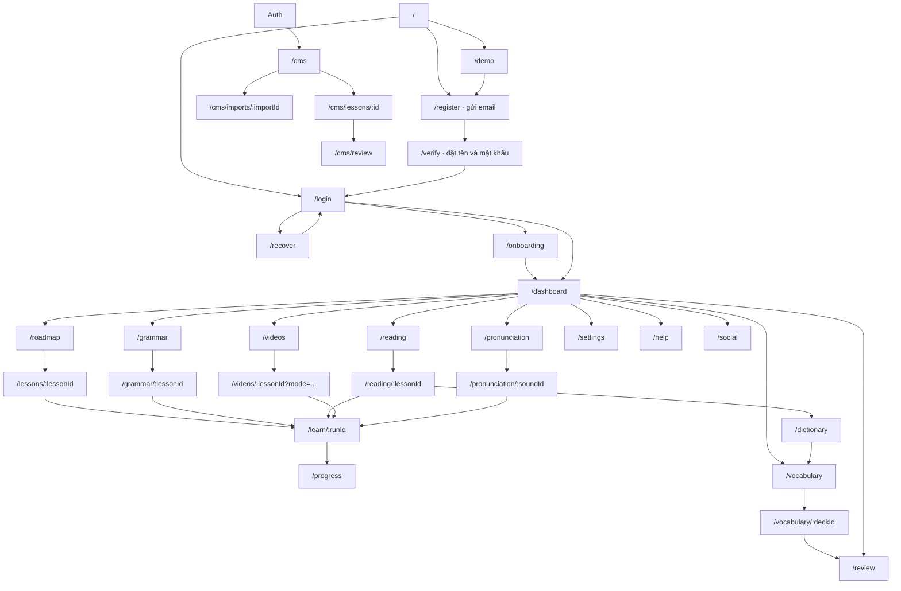

# Sitemap — sản phẩm mới

**Trạng thái** PROPOSED. Route App Router dưới đây dành cho web mới. [Sitemap khảo sát](../research/01-site-exploration.md) ghi URL AIO English. API có namespace riêng tại [API spec](../architecture/05-api-specification.md).

| Nhóm và trạng thái | Route | Quyền / điều hướng | FR |
| --- | --- | --- | --- |
| Landing/demo · MVP | `/`, `/demo`, `/legal/*` | Public. Landing có về dashboard sau đăng nhập, demo CTA đăng ký. | FR-LAND-001 |
| Auth · MVP | `/login`, `/register`, `/verify`, `/recover` | Public. Register chỉ nhập email. /verify đặt tên và mật khẩu qua token. Người học đăng nhập sau verify. Target sau auth thuộc allowlist nội bộ. | FR-AUTH-001 |
| Onboarding · MVP | `/onboarding` | Learner đã xác minh và đăng nhập, route bắt buộc khi chưa hoàn tất. Chọn CEFR, mục tiêu kỳ thi tùy chọn, múi giờ và vi/en. | FR-AUTH-001 |
| Home và theo dõi · MVP/V2 | `/dashboard`, `/progress` | Learner. Resume, mục tiêu, due, sau mới XP và streak. | FR-PROG-001, FR-GAME-001 |
| Lộ trình và run · MVP | `/roadmap`, `/lessons/[lessonId]`, `/learn/[runId]` | Lesson UUID ổn định. Run do learner sở hữu, renderer theo mode, gắn version. Completion có route logic trong run. | FR-CUR-001, FR-TYPE-001 |
| Từ vựng · MVP | `/vocabulary`, `/vocabulary/[deckId]`, `/review` | Learner. Deck detail, bộ đã lưu và hàng đến hạn. | FR-VOCAB-001, FR-SRS-001 |
| Thiết lập · MVP/V2 | `/settings` | Learner. Preference, mục tiêu phút/ngày từ S4 và yêu cầu quyền dữ liệu sau xác thực lại 10 phút. | FR-SET-001 |
| CMS · MVP | `/cms`, `/cms/imports/[importId]`, `/cms/lessons/[id]`, `/cms/review` | Staff. Route bảo vệ theo vai trò, hành động publish riêng admin. | FR-CMS-001 |
| Grammar và dictionary · V1 | `/grammar`, `/grammar/[lessonId]`, `/dictionary?q=` | Grammar và dictionary cần learner. Grammar theo dõi tiến độ trong run. | FR-GRAM-001, FR-DICT-001 |
| Reading và translation · V1/V2 | `/reading`, `/reading/[lessonId]`, `/learn/[runId]` | Learner. Dịch chọn chiều trước start. Kết quả và AI job panel trong run. | FR-READ-001, FR-TRANS-001, FR-AI-001 |
| Video và luyện âm · V1 | `/videos`, `/videos/[lessonId]?mode=`, `/pronunciation`, `/pronunciation/[soundId]` | Learner. `soundId` là ID bài IPA đã công bố. Mode viewer `subtitles`, `dictation`, `shadowing`, `quiz`. Mode quy định render/media và có thể tạo run riêng. | FR-VIDEO-001, FR-DICTATION-001, FR-SHADOW-001, FR-IPA-001 |
| Trợ giúp · V1 | `/help` | FAQ public. Báo lỗi khi learner, vào được từ footer và lesson action. | FR-HELP-001 |
| Xã hội · V2 điều kiện | `/social` | Learner opt-in. Khi không phát hành, route vô hiệu và UI không dẫn. | FR-SOC-001 |

## Quy tắc chuyển cảnh

- Breadcrumb giữ đầu mối quay về catalog. Navigation ở exercise chỉ thêm nút trợ giúp/ngắt phiên cần thiết, phím tắt ngoài text composition phải được mô tả.
- Loading route có skeleton mang heading. Error do hết phiên dẫn login giữ route hợp lệ. Forbidden và not-found có thông điệp phù hợp. Lỗi publish/version trong CMS hiện trong context và giữ draft.
- Locale trình bày ưu tiên vi-VN, cue/phrase có lang theo nội dung. Filter URL chỉ cho tham số cần chia sẻ. Token xác minh/reset cần đổi thành trạng thái server rồi làm sạch URL theo thiết kế auth.
- URL chi tiết là ID bất biến. Mỗi item trong run lấy thứ tự chuẩn từ API, frontend không tự tạo tiến độ. Bản xuất bản bị thu hồi có flow về danh mục và link báo tình trạng.

[Đặc tả màn hình](03-screen-specifications.md) · [Kiến trúc frontend](../architecture/02-frontend-architecture.md)
