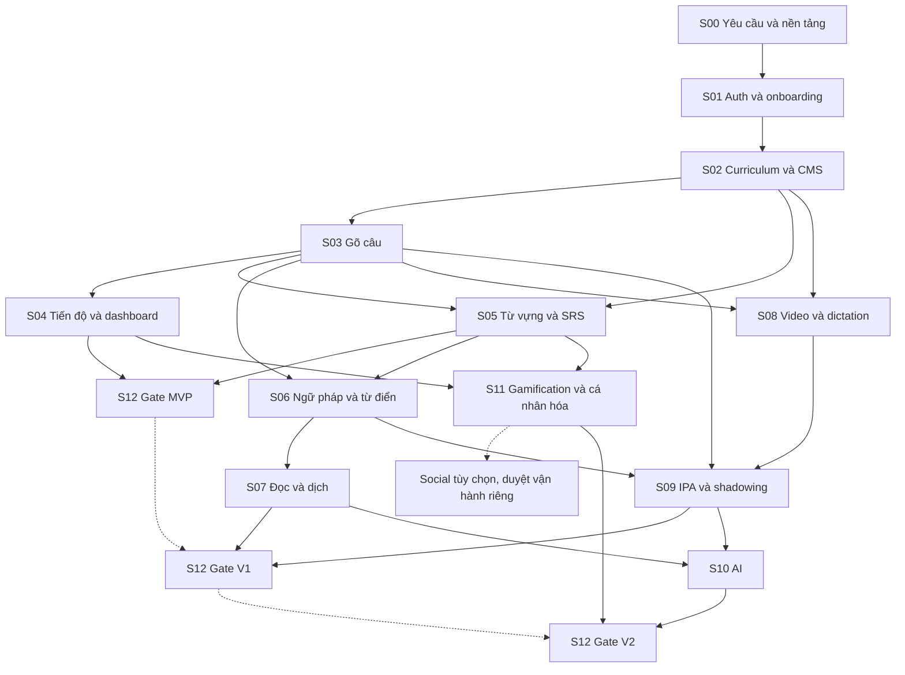

# Lộ trình phát triển và phát hành

**PROPOSED** cho nền tảng mới. Sprint là gói công việc có đầu ra nghiệm thu. Từng kế hoạch sprint ghi phạm vi, phụ thuộc, tác vụ dữ liệu, backend, frontend, nội dung, QA, bảo mật, điều kiện hoàn tất và commit tham khảo. [PRD](../requirements/01-PRD.md) · [SRS](../requirements/02-SRS.md) · [Kiến trúc](../architecture/01-system-architecture.md)

## Phụ thuộc triển khai

Mũi tên liền mô tả đầu vào kỹ thuật hoặc điều kiện gộp release. Mũi tên nét đứt mô tả thứ tự qua cổng phát hành và nhánh tùy chọn. Có thể biên tập deck sau S02 song song với Gõ câu. Tự lưu từ và backfill của S05 cần completion đã commit của S03, còn tích hợp dashboard cần read model S04. Sau khi scorer ổn định, video/cue có thể làm song song với từ điển. Hai nhánh S10 và S11 có thể chạy song song rồi qua cùng gate V2.

## Kế hoạch theo sprint

| Sprint | Kết quả kiểm tra được | Hạng mục trước | Ngày công kỹ thuật |
|---|---|---|---:|
| [00 — Yêu cầu và nền tảng](sprint-00.md) | ADR đã chốt, nền local và CI có smoke chạy được. | Blueprint | 5–8 |
| [01 — Xác thực và onboarding](sprint-01.md) | Đăng ký email, thiết lập credentials sau xác minh, phiên opaque, phục hồi, onboarding, export và erase có step-up. | 00 | 11–16 |
| [02 — Curriculum và CMS](sprint-02.md) | Course, unit, lesson, draft/import/review/publish, lane Gõ câu và nghĩa mục tiêu đã ghim. | 01 | 9–12 |
| [03 — Gõ câu](sprint-03.md) | Grader, player, hint, demo, resume/replay theo lane, completion và ledger XP MVP. | 02 | 9–13 |
| [04 — Tiến độ và dashboard](sprint-04.md) | Continue, trạng thái bài, mục tiêu, thời gian theo ngày và XP cá nhân. | 03 | 8–12 |
| [05 — Từ vựng và SRS](sprint-05.md) | Deck, kho từ tự lưu từ completion, backfill, ghi danh theo chiều và review có lịch/log. | 02, 03; kết nối dashboard với 04 | 8–11 |
| [06 — Ngữ pháp và từ điển](sprint-06.md) | Bài ngữ pháp có quiz/lời giải và từ điển dùng chung lexical entry. | 02, 03, 05 | 7–10 |
| [07 — Đọc và dịch](sprint-07.md) | Song ngữ theo đoạn, tra từ, dịch và feedback cơ bản, góp ý riêng tư. | 03, 06 | 9–13 |
| [08 — Video và dictation](sprint-08.md) | Media có cue, playback/chuyển tốc độ, phụ đề, lặp và dictation. | 02, 03 | 7–11 |
| [09 — IPA và shadowing](sprint-09.md) | IPA, shadowing theo cue và Gõ câu Nghe & nói Nâng cao. Ghi/phát cục bộ và tự xác nhận. | 03, 06, 08 | 6–9 |
| [10 — AI](sprint-10.md) | Feedback dịch, STT/TTS, tutor sau eval, opt-in và chi phí. | 07, 09 | 12–17 |
| [11 — Gamification và cá nhân hóa](sprint-11.md) | Mở rộng từ ledger XP MVP với streak, leaderboard, thành tích và gợi ý bài. Social nếu đủ điều kiện. | 03, 04, 05 | 6–10 |
| [12 — Kiểm thử và production](sprint-12.md) | Kiểm tra tải, WCAG, quyền, rollout, backup/restore và rollback. | Sau 05 cho MVP, 09 cho V1, 11 cho V2 cùng kết quả của các mô-đun trong release | 7–11 mỗi gate |

Ngày công cộng từ các task chi tiết, gồm kiểm thử trong sprint. Tổng dự kiến **57–83** cho MVP, thêm **36–54** cho V1 và **25–38** cho V2, gồm một lần Sprint 12 mỗi release. Các số này là khối lượng công việc, còn thời gian lịch phụ thuộc số người, độ song song, rủi ro và thời gian chờ cấp quyền. Giả định có hai kỹ sư full-time chia ownership frontend/backend, một người biên tập tiếng Anh–Việt 0,5 FTE, và QA/SRE hỗ trợ khoảng 0,5 FTE theo giai đoạn. Dự toán chưa gồm mua quyền, thu âm theo lô, nhập nội dung dài hạn, hỗ trợ vận hành và phát triển social nếu được duyệt. Đánh giá lại ở Sprint 0 và sau sản xuất trọn một unit mẫu.

## Cổng theo phiên bản

| Release | Điều kiện nghiệp vụ và dữ liệu | Bằng chứng cần lưu |
|---|---|---|
| MVP · S00–S05 + S12 | Từ landing qua xác minh/onboarding đến A1, gõ, resume/replay theo lane, tổng kết và tiến độ. XP cơ bản một lần mỗi lesson đủ điều kiện. Completion và backfill đưa nghĩa đã biên soạn vào kho; người dùng chọn nghĩa và chiều để ghi danh SRS. Editor có quyền rõ và Admin xuất bản qua bước duyệt. Session, CSRF, export/erase, idempotency, WCAG và restore đạt gate. | E2E desktop/mobile, race DB, cutover/backfill, quyền học liệu, trace retry, kiểm thử quyền dữ liệu và biên bản restore. |
| V1 · S06–S09 + S12 | Tiếp tục chạy gate MVP. Grammar/dictionary, đọc và dịch rule-based, clip song ngữ, dictation, IPA, shadowing và Gõ câu Nghe & nói Nâng cao hoạt động trên thiết bị mục tiêu. Có fallback media, mạng và mic. | Cue/audio, ma trận thiết bị, license, bàn phím, phụ đề, cleanup bản ghi cục bộ, `QA-TYPE-17` và baseline tải. |
| V2 · S10–S11 + S12 | Tiếp tục chạy gate V1. Streak, leaderboard và thành tích đọc từ dữ liệu đã commit, cá nhân hóa theo quy tắc đã duyệt. Chỉ bật AI khi privacy, consent, chi phí, eval và fallback đạt. Social qua đánh giá opt-in riêng và có owner vận hành. | Gold eval versioned, báo cáo cost/cap, stress concurrency, bằng chứng thu hồi quyền, policy social nếu bật và trạng thái feature flag. |

Sprint 12 là một bộ việc lặp lại. Bắt đầu thu thập tín hiệu và dựng kiểm thử ngay từ Sprint 0. Thời điểm phát hành chỉ sau khi cổng tương ứng đạt và có lệnh rollback đã xác minh. [Chiến lược QA](../testing/01-test-strategy.md) · [NFR](../requirements/05-non-functional-requirements.md)

## Các quyết định cần chốt

| Mốc chốt | Quyết định | Owner và tiêu chí |
|---|---|---|
| Trước chạy pilot | Nhà cung cấp hosting, region, domain, backup và ngân sách. | Chủ dự án + Platform. Lấy báo giá, đối chiếu yêu cầu lưu dữ liệu và thử restore với RPO/RTO trong NFR. |
| Trước gửi thư staging | Email transactional và sender DNS. | Chủ dự án + Identity. Kiểm DPA, SPF/DKIM, quota và cảnh báo. Local dùng mail sink khi triển khai Sprint 01. |
| Trước thu dữ liệu thật | Điều kiện độ tuổi, retention, quyền dữ liệu và phạm vi thị trường. | Chủ dự án + Legal. Duyệt chính sách theo thị trường, người xử lý yêu cầu và dữ liệu tối thiểu. CI/staging dùng dữ liệu tổng hợp. |
| Trước Sprint 02 publish pilot | Tên thương hiệu, tập A1 đầu tiên, quyền thương mại, accent và attribution. | Chủ dự án + Nội dung + Legal. Duyệt một unit nguyên bản, bản quyền và manifest. |
| Trước Sprint 8–9 | Codec, thiết bị tối thiểu, giọng đọc, rights, consent và retention với bản ghi. | Media + Security + QA. Thử Chrome/Firefox/Safari/iOS, đo cue, thu lại mẫu và xác nhận access/retention. |
| Trước Sprint 10 | Nhà cung cấp LLM/STT/TTS, nơi xử lý, chi phí trần, gold set và điều kiện mở cờ. | AI Lead + Product + Legal. So chất lượng theo rubric, cohort và cost, chạy timeout/fallback, rà retention. Sau đánh giá mới bật. |
| Trước Sprint 11 | Quy tắc streak/achievements, gợi ý bài, leaderboard/friends và điều kiện vận hành. | Product + Trust & Safety. Dùng dữ liệu pilot, chốt quyền xuất hiện, thu hồi, hỗ trợ và kiểm duyệt. |

Các quyết định về monorepo, HTTP local/CI, hai trục Gõ câu, điểm, XP MVP và kho từ đã ghi trong ADR. Các quyết định production còn mở tách khỏi cổng local và kế hoạch bắt đầu Sprint 01. [ADR công cụ](../architecture/adr/0001-local-toolchain-and-monorepo.md) · [ADR HTTP và quyết định mở](../architecture/adr/0002-http-and-deployment-baseline.md) · [ADR học tập](../architecture/adr/0003-learning-variants-rewards-vocabulary.md) · [Sprint 00](sprint-00.md) · [Sprint 01](sprint-01.md)
