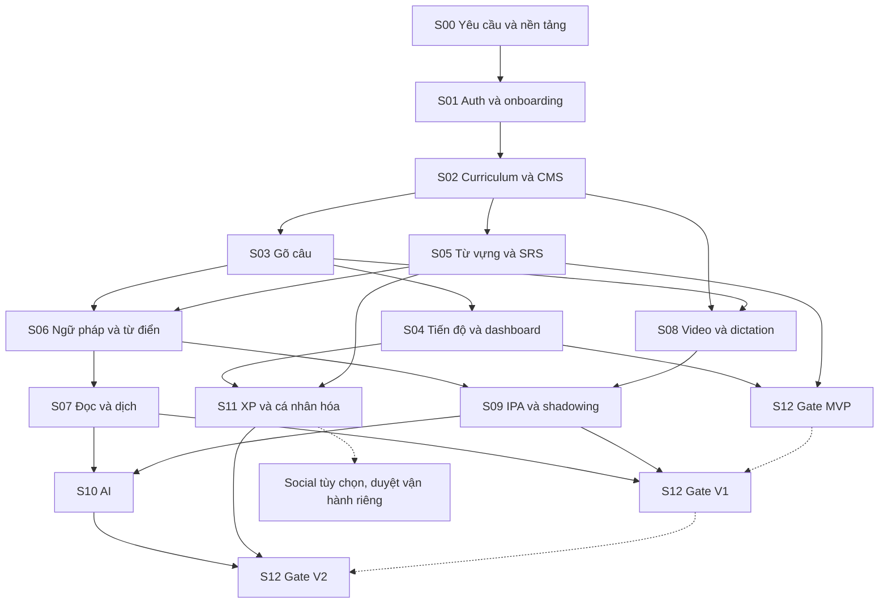

# Lộ trình phát triển và phát hành

**PROPOSED** cho nền tảng mới. Sprint là gói công việc có đầu ra nghiệm thu. Từng kế hoạch sprint ghi phạm vi, phụ thuộc, tác vụ dữ liệu, backend, frontend, nội dung, QA, bảo mật, điều kiện hoàn tất và commit tham khảo. [PRD](../requirements/01-PRD.md) · [SRS](../requirements/02-SRS.md) · [Kiến trúc](../architecture/01-system-architecture.md)

## Phụ thuộc triển khai

Mũi tên liền mô tả đầu vào kỹ thuật hoặc điều kiện gộp release. Mũi tên nét đứt mô tả thứ tự qua cổng phát hành và nhánh tùy chọn. Chi tiết song song theo mã task nằm trong từng sprint. Sau CMS, có thể biên tập deck song song với typing. Sau khi scorer ổn định, nhóm media có thể dựng video và cue trong lúc nhóm từ vựng hoàn thiện từ điển. Sau progress/SRS, Sprint 11 có thể chạy song song với Sprint 10 khi mỗi nhóm có đủ đầu vào. Theo thứ tự triển khai V2, cả hai nhánh vẫn phải qua cùng gate.

## Kế hoạch theo sprint

| Sprint | Kết quả kiểm tra được | Hạng mục trước | Ngày công kỹ thuật |
|---|---|---|---:|
| [00 — Yêu cầu và nền tảng](sprint-00.md) | ADR đã chốt, nền local và CI có smoke chạy được. | Blueprint | 5–8 |
| [01 — Xác thực và onboarding](sprint-01.md) | Đăng ký email, thiết lập credentials sau xác minh, phiên opaque, phục hồi, onboarding, export và erase có step-up. | 00 | 11–16 |
| [02 — Curriculum và CMS](sprint-02.md) | Course, unit, lesson, draft, import, review, publish nguyên tử và catalog. | 01 | 9–12 |
| [03 — Gõ câu](sprint-03.md) | Scorer tất định, player, hint, nộp lặp an toàn, demo, resume và completion. | 02 | 9–13 |
| [04 — Tiến độ và dashboard](sprint-04.md) | Continue, trạng thái bài, mục tiêu và thời gian theo ngày của người học. | 03 | 8–12 |
| [05 — Từ vựng và SRS](sprint-05.md) | Deck, lưu từ, flashcards và review có lịch và log. | 02, kết nối dashboard với 04 khi gộp MVP | 8–11 |
| [06 — Ngữ pháp và từ điển](sprint-06.md) | Bài ngữ pháp có quiz/lời giải và từ điển dùng chung lexical entry. | 02, 03, 05 | 7–10 |
| [07 — Đọc và dịch](sprint-07.md) | Song ngữ theo đoạn, tra từ, dịch và feedback cơ bản, góp ý riêng tư. | 03, 06 | 9–13 |
| [08 — Video và dictation](sprint-08.md) | Media có cue, playback/chuyển tốc độ, phụ đề, lặp và dictation. | 02, 03 | 7–11 |
| [09 — IPA và shadowing](sprint-09.md) | IPA có audio, shadowing theo cue, ghi và nghe lại qua browser. | 06, 08 | 6–9 |
| [10 — AI](sprint-10.md) | Feedback dịch, STT/TTS, tutor sau eval, opt-in và chi phí. | 07, 09 | 12–17 |
| [11 — Gamification và cá nhân hóa](sprint-11.md) | XP, chuỗi, thành tích, gợi ý và social nếu đủ điều kiện. | 04, 05 | 6–10 |
| [12 — Kiểm thử và production](sprint-12.md) | Kiểm tra tải, WCAG, quyền, rollout, backup/restore và rollback. | Sau 05 cho MVP, 09 cho V1, 11 cho V2 cùng kết quả của các mô-đun trong release | 7–11 mỗi gate |

Ngày công cộng từ các task chi tiết, gồm kiểm thử trong sprint. Tổng dự kiến **57–83** cho MVP, thêm **36–54** cho V1 và **25–38** cho V2, gồm một lần Sprint 12 mỗi release. Các số này là khối lượng công việc, còn thời gian lịch phụ thuộc số người, độ song song, rủi ro và thời gian chờ cấp quyền. Giả định có hai kỹ sư full-time chia ownership frontend/backend, một người biên tập tiếng Anh–Việt 0,5 FTE, và QA/SRE hỗ trợ khoảng 0,5 FTE theo giai đoạn. Dự toán chưa gồm mua quyền, thu âm theo lô, nhập nội dung dài hạn, hỗ trợ vận hành và phát triển social nếu được duyệt. Đánh giá lại ở Sprint 0 và sau sản xuất trọn một unit mẫu.

## Cổng theo phiên bản

| Release | Điều kiện nghiệp vụ và dữ liệu | Bằng chứng cần lưu |
|---|---|---|
| MVP · S00–S05 + S12 | Người mới đi từ landing đến xác minh, onboarding, chọn bài A1, gõ, reload/resume, hoàn thành và nhìn thấy tiến độ. Có thể quay lại học và ôn thẻ đến hạn. Editor tạo nội dung có quyền rõ và Admin xuất bản qua bước duyệt. Session, CSRF, quyền export/erase, attempt idempotency, origin, WCAG và restore đạt chuẩn. | E2E desktop/mobile, race test DB, nội dung cấp quyền, trace retry, kiểm thử quyền dữ liệu, checklist accessibility và biên bản restore. |
| V1 · S06–S09 + S12 | Luồng MVP tiếp tục qua gate. Grammar/dictionary, đọc và dịch rule-based, clip song ngữ, dictation, IPA, shadowing hoạt động trên thiết bị mục tiêu. Có fallback khi media thiếu, lỗi mạng hoặc người dùng từ chối mic. | Test cue và audio, bảng thiết bị, media license, UI kiểm thử bàn phím, phụ đề, file recording TTL và baseline tải. |
| V2 · S10–S11 + S12 | Luồng V1 tiếp tục qua gate. XP và thành tích tránh ghi trùng. Cá nhân hóa theo quy tắc đã chốt. Các tính năng AI chỉ bật khi privacy, consent, chi phí, eval và fallback đã đạt. Social đánh giá riêng với opt-in và người sở hữu vận hành. | Gold eval versioned, báo cáo cost/cap, stress concurrency, bằng chứng thu hồi quyền, policy social nếu bật và trạng thái feature flags. |

Sprint 12 là một bộ việc lặp lại. Bắt đầu thu thập tín hiệu và dựng kiểm thử ngay từ Sprint 0. Thời điểm phát hành chỉ sau khi cổng tương ứng đạt và có lệnh rollback đã xác minh. [Chiến lược QA](../testing/01-test-strategy.md) · [NFR](../requirements/05-non-functional-requirements.md)

## Các quyết định cần chốt

| Mốc chốt | Quyết định | Owner và tiêu chí |
|---|---|---|
| Sprint 0 | Tên, phạm vi A1, đối tượng đầu tiên, chính sách quyền truy cập và điều kiện mở khóa. | Product + EdTech. Chọn theo một hành trình học trọn vẹn, unit mẫu, số giờ biên tập và khả năng đo kết quả. |
| Sprint 0 | Nhà cung cấp hạ tầng, region, môi trường, backup, chi phí và RPO/RTO. | Tech Lead + SRE + người chịu ngân sách. Lấy báo giá, xác nhận vị trí dữ liệu và chạy thử restore đối với cấu hình ưu tiên. |
| Trước Sprint 1 | Miền, email transactional, chính sách xác minh và khôi phục, yêu cầu quyền riêng tư và người học chưa thành niên. | Product + Security + Legal. Chốt xử lý dữ liệu, TTL, trường hồ sơ tối thiểu, gửi thư thử và người xử lý yêu cầu bảo vệ dữ liệu tại thị trường ra mắt. |
| Trước Sprint 2 | Nguồn nội dung, quyền thương mại, accent, chính sách phái sinh, hồ sơ quyền và khối lượng MVP. | Content Lead + Legal. Duyệt một unit nguyên bản, nguồn fallback và quy trình nhập/xuất bản có audit. |
| Trước Sprint 3 | Chính sách normalize, hint/reveal và chuyển bài ảnh hưởng đến kết quả sư phạm. | EdTech + QA. So corpus câu chuẩn/sai, tập biến thể có duyệt và thử luồng với người học. |
| Trước Sprint 4–5 | Múi giờ, cách đếm thời gian/ngày, độ dễ của rating và due. | Product + EdTech + Backend. Chọn snapshot theo ngày, tiêu chí streak sau này và bộ fixture ngày biên. |
| Trước Sprint 8–9 | Codec, thiết bị tối thiểu, giọng đọc, rights, consent và retention với bản ghi. | Media + Security + QA. Thử Chrome/Firefox/Safari/iOS, đo cue, thu lại mẫu và xác nhận access/retention. |
| Trước Sprint 10 | Nhà cung cấp LLM/STT/TTS, nơi xử lý, chi phí trần, gold set và điều kiện mở cờ. | AI Lead + Product + Legal. So chất lượng theo rubric, cohort và cost, chạy timeout/fallback, rà retention. Sau đánh giá mới bật. |
| Trước Sprint 11 | Ngưỡng XP, gợi ý bài tiếp, leaderboard/friends và điều kiện vận hành tùy chọn. | Product + Trust & Safety. Chốt quyền xuất hiện, thao tác thu hồi, hỗ trợ, kiểm duyệt và cách hạn chế gian lận. |

Thứ tự chuẩn bị triển khai là chốt các quyết định Sprint 0, chạy smoke môi trường và review quyền cùng dữ liệu mẫu. [Sprint 00](sprint-00.md) · [Sprint 01](sprint-01.md)
