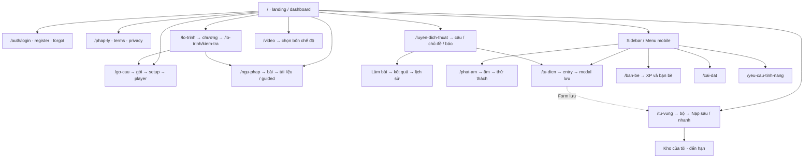

# Kiểm kê từng trang đã mở

Ngày 19/11/2026, phiên learner. Các route công khai được mở trong trình duyệt đã có phiên, trừ trạng thái landing hiển thị trước khi khôi phục phiên. Trong bảng, Learner nghĩa là điều kiện của lần khảo sát. Quy tắc chặn khách của từng route chưa được thử riêng. Query, alias và popup được ghi cùng màn hình chính. Các số đếm và gói nội dung là dữ liệu hiển thị tại thời điểm khảo sát.

| URL | Điều kiện / vai trò | Mục đích | UI, dữ liệu và navigation | Thao tác, validation hoặc trạng thái đo được | Lỗi, empty và giới hạn chưa xác minh | Bằng chứng |
|---|---|---|---|---|---|---|
| `/` | Công khai → learner | Giới thiệu hoặc bắt đầu học | Public hero, demo CTA, FAQ và legal; learner header, plan, level, XP tháng và module links. | Hydration từ landing sang dashboard; 0/7, 0/180→2/180; mục tiêu mở overlay, CTA bài điều hướng sang player. | Demo trọn vòng, xếp hạng Bạn bè và sửa mục tiêu chưa thử. | [RT-01](06-evidence-and-screenshots.md#rt-01), [RT-05](06-evidence-and-screenshots.md#rt-05), [RT-06](06-evidence-and-screenshots.md#rt-06), [RT-10](06-evidence-and-screenshots.md#rt-10) |
| `/auth/login` | Công khai | Đăng nhập | Email, mật khẩu, form đăng nhập, Google, quên mật khẩu, pháp lý. | Trạng thái ban đầu rỗng; có các lối auth/register và auth/forgot. | Không thử thông tin sai, OAuth hay thành công login. | [RT-02](06-evidence-and-screenshots.md#rt-02) |
| `/auth/register` | Công khai | Tạo tài khoản | Email, hai ô mật khẩu, Google, điều khoản. | Gửi disabled khi trống; link quay lại login. | Onboarding và server validation chưa thử. | [RT-03](06-evidence-and-screenshots.md#rt-03) |
| `/auth/forgot` | Công khai | Bắt đầu khôi phục | Email và nút gửi liên kết, lối login. | Biểu mẫu ban đầu; không gửi yêu cầu. | Email, timeout, thử lại và reset token chưa thử. | [RT-03](06-evidence-and-screenshots.md#rt-03) |
| `/phap-ly` | Công khai | Điều khoản/privacy | Các tài liệu VI/EN, mục xóa tài khoản. | Links sang Điều khoản và Quyền riêng tư đã mở. | Tài liệu EN chưa mở. | [RT-04](06-evidence-and-screenshots.md#rt-04) |
| `/phap-ly/dieu-khoan` | Công khai | Điều khoản dịch vụ | Nội dung theo mục, dịch vụ miễn phí, sở hữu trí tuệ và AI. | Heading và mục nội dung đọc được. | Không xác nhận điều khoản mới. | [RT-04](06-evidence-and-screenshots.md#rt-04) |
| `/phap-ly/quyen-rieng-tu` | Công khai | Chính sách xử lý dữ liệu | Các mục dữ liệu, cookie, mic, AI, lưu/chia sẻ, xóa. | Thông tin công bố hiển thị. | Quy trình thực thi xóa/xuất chưa thử. | [RT-04](06-evidence-and-screenshots.md#rt-04), [RT-08](06-evidence-and-screenshots.md#rt-08) |
| `/cai-dat` | Learner | Hồ sơ, thiết lập và riêng tư | Điều hướng theo heading, form profile, goal/level, voice, theme, motion và privacy. | Lựa chọn hiện hành/pressed, switch checked; nút chỉnh target thay trạng thái sau tải. | Không ghi settings, tạo link mới hay thay thông tin. | [RT-07](06-evidence-and-screenshots.md#rt-07), [RT-08](06-evidence-and-screenshots.md#rt-08) |
| `/ban-be` | Learner | Tiến độ và bạn bè | Kế hoạch, hồ sơ, tuần, bạn bè, tìm ID, invite, XP. | Tìm disabled trước nhập; danh sách trống; mở dialog XP; có đề xuất kết bạn. | Không gửi lời mời, điểm danh hoặc đổi privacy. | [RT-09](06-evidence-and-screenshots.md#rt-09), [RT-10](06-evidence-and-screenshots.md#rt-10) |
| `/yeu-cau-tinh-nang` | Learner | Phản hồi sản phẩm | Form tên/mô tả, sort, filter trạng thái, Của tôi, vote/comment. | Nút gửi disabled khi trống; chuyển Mới nhất/Của tôi, trang báo chưa có ý tưởng của mình. | Không đăng nội dung, comment hay vote. | [RT-11](06-evidence-and-screenshots.md#rt-11) |
| `/go-cau` | Learner | Khám phá bộ bài gõ | Nhóm A1–C1, đời sống, công việc, điều hướng, utility và CTA. | Desktop sidebar, mobile tabbar + Menu; test mở hai gói; popup có Để sau. | Chưa kích hoạt mọi chủ đề, utility chỉ thấy CTA. | [RT-12](06-evidence-and-screenshots.md#rt-12), [RT-13](06-evidence-and-screenshots.md#rt-13) |
| `/go-cau/lo-trinh-a1` | Learner | Mục lục gói A1 | 84 bài, chương accordion, badge độ khó, setup dialog. | Bài 1 0%→8% giữa chừng. Sau hoàn tất Nâng cao, gói 1/84 và bài Trọn bộ, nhãn đủ ba độ khó. Chọn lại mở setup. | Mở lại đã quan sát tới setup, chưa chạy lượt mới. | [RT-13](06-evidence-and-screenshots.md#rt-13), [RT-14](06-evidence-and-screenshots.md#rt-14), [RT-19](06-evidence-and-screenshots.md#rt-19) |
| `/go-cau/lo-trinh-a1/crs_c9ac3ba0d8ae726835` | Learner | Player bài A1 | EN/VI, audio, input, feedback, next, settings, pause, mode và summary. | Cơ bản 49, Nâng cao 24; sai giữ input. Resume khôi phục số đã làm. Tiếp tục sau 24/24 mở tổng kết. Lỗi Không tải được khoá học có nút Thử lại và đã khôi phục. | Mic chưa cấp, blank bị chặn, công thức điểm tổng chưa xác minh. | [RT-14](06-evidence-and-screenshots.md#rt-14), [RT-15](06-evidence-and-screenshots.md#rt-15), [RT-16](06-evidence-and-screenshots.md#rt-16), [RT-17](06-evidence-and-screenshots.md#rt-17), [RT-18](06-evidence-and-screenshots.md#rt-18), [RT-19](06-evidence-and-screenshots.md#rt-19), [RT-20](06-evidence-and-screenshots.md#rt-20) |
| `/go-cau/du-lich` | Learner | Mục lục chủ đề Du lịch | 36 bài nhóm A1–B2, CTA, tiến độ và badge. | Chọn bài 1 → setup, đổi Mặc định/Trung cấp. | Chưa kiểm mọi nhóm. | [RT-13](06-evidence-and-screenshots.md#rt-13), [RT-14](06-evidence-and-screenshots.md#rt-14) |
| `/go-cau/du-lich/crs_de6b8251568427d00a` | Learner | Bài chủ đề ở Trung cấp | Bài đầu, 83 mục, input, điều khiển có phím tắt. | Ô nhập focus; mở pause ra dialog, thấy Ctrl/Alt/Ctrl+Alt/Enter. | Không gửi đáp án trong bài thứ hai. | [RT-14](06-evidence-and-screenshots.md#rt-14), [RT-17](06-evidence-and-screenshots.md#rt-17), [RT-18](06-evidence-and-screenshots.md#rt-18) |
| `/tu-vung` | Learner | Catalog và kho cá nhân | Thẻ theo chủ đề/CEFR/thi; tab của tôi, kho SRS, tạo bộ và AI. | `?tab=cua-toi` ban đầu trống. Sau tổng kết Gõ câu, hiển thị 8/8 từ và hết từ đến hạn hôm nay. AI disabled khi trống; hủy form. | Nút lưu, lịch ôn thật, favorite/khó chưa kiểm. | [CV-01](06-evidence-and-screenshots.md#cv-01), [CV-02](06-evidence-and-screenshots.md#cv-02), [RT-19](06-evidence-and-screenshots.md#rt-19) |
| `/tu-vung/oxford-3000` | Learner | Bộ từ chia theo trình độ | A1–B2, chủ đề, số từ và progress. | `?cap=a2` đổi tab và số nhóm; modal Nạp sâu/Nạp nhanh. | Chưa kiểm đủ các levels/sets. | [CV-03](06-evidence-and-screenshots.md#cv-03) |
| `/tu-vung/oxford-3000/vset_8ebfa3f8a626e3190f/hoc` | Learner | Nạp từ và flashcard | Thẻ từ/nghĩa/IPA, phát âm, phím, cài đặt; fast có flip, đổi chiều và rating. | Chọn 5 qua Nạp sâu tới 1/25; `?mode=nhanh` lật và kết thúc 0 từ/+0 XP. | Nộp deep bị chặn, không quan sát due thật. | [CV-04](06-evidence-and-screenshots.md#cv-04), [CV-05](06-evidence-and-screenshots.md#cv-05) |
| `/ngu-phap` | Learner | Catalog ngữ pháp | Tab lộ trình và cốt lõi, level A1–C2, mastery. | Chuyển tab; chương và điểm ngữ pháp theo level. | Chưa kiểm mọi level và blank. | [CV-06](06-evidence-and-screenshots.md#cv-06) |
| `/ngu-phap/a1-to-be` | Learner | Bài ngữ pháp và thang mastery | Guided, 20 câu có gợi ý, 20 không gợi ý, tài liệu. | 0/3; hai tầng practice có khóa trước hướng dẫn. | Chưa xác minh mở khóa sau hoàn thành hoặc độ bền. | [CV-07](06-evidence-and-screenshots.md#cv-07) |
| `/ngu-phap/a1-to-be-negative` | Learner | Bài trong chương tiếp theo | Detail bài ngữ pháp và CTA Bắt đầu. | Vào từ chương 2 khi chương trước chưa xong. | Không suy ra mọi bài mở tự do. | [CV-09](06-evidence-and-screenshots.md#cv-09) |
| `/ngu-phap/tai-lieu/dong-tu-be-have-got` | Learner | Tài liệu lý thuyết | Nội dung, ví dụ, mục lục và link về bài. | Theo `?node=a1-to-be`; mở từ detail, nội dung đọc được. | Chưa kiểm tất cả liên kết mục lục. | [CV-07](06-evidence-and-screenshots.md#cv-07) |
| `/ngu-phap/a1-to-be/hoc` | Learner | Guided practice | Quy tắc/viết lại mẫu → choice, gợi ý và Bài trước. | `?mode=guided`; Next tới bài điền ba lựa chọn. | Submit bị auto-review chặn, chưa xác minh chấm. | [CV-08](06-evidence-and-screenshots.md#cv-08) |
| `/lo-trinh` | Learner | Đường học A1–C1 | Tiến độ, thời gian, cấp, chương, mục tiêu, mở bài/kiểm tra. | Chương sau truy cập; modal đổi cấp/mục tiêu hủy, lưu disabled khi không đổi. | Chưa lưu thay đổi hay kiểm mọi prerequisite. | [CV-09](06-evidence-and-screenshots.md#cv-09) |
| `/lo-trinh/kiem-tra` | Learner | Thông tin kiểm tra cấp | 36 câu, 40 phút, yêu cầu 29/36 và 7/12 mỗi phần. | CTA hiển thị tại 0%; 80% khuyến nghị. UI mô tả cooldown. | Không bắt đầu vì tiêu thụ lượt, chưa đo scoring/timer. | [CV-10](06-evidence-and-screenshots.md#cv-10) |
| `/luyen-dich-thuat` | Learner | Chọn đọc/dịch và lịch sử | Random/lesson, đề xuất chủ đề, nhà xuất bản, bài riêng, lịch sử. | Form URL/plain text/AI; một kết quả 88 xuất hiện sau khi quay lại. | Không tạo bài riêng hoặc gửi URL vào form. | [MV-01](06-evidence-and-screenshots.md#mv-01), [MV-08](06-evidence-and-screenshots.md#mv-08), [MV-10](06-evidence-and-screenshots.md#mv-10) |
| `/luyen-dich-thuat/tung-cau/ngau-nhien` | Learner | Dịch câu không theo bài | A1, Việt→Anh, input, gợi ý, feedback, next. | Blank disabled; hint 0/2→1/2. Đúng bằng Enter; sai có chấm lại và giải thích. | Model/hạn mức và persistence riêng chưa kiểm. | [MV-02](06-evidence-and-screenshots.md#mv-02), [MV-03](06-evidence-and-screenshots.md#mv-03) |
| `/luyen-dich-thuat/tung-cau/theo-bai` | Learner | Dịch theo bài | Danh sách 15 câu, tiến độ, chọn mục. | Chọn 2 đổi cursor và chỉ dấu. | Chưa làm hết hoặc xác minh khóa. | [MV-04](06-evidence-and-screenshots.md#mv-04) |
| `/luyen-dich-thuat/chu-de/du-lich` | Learner | Đọc/dịch theo chủ đề | Sidebar nhóm, CEFR filter, thẻ dẫn sang bài. | Alias `/luyen-dich-thuat/chu-de` vào chủ đề mặc định; A2 đổi nội dung. | Chưa mở các chủ đề còn lại. | [MV-05](06-evidence-and-screenshots.md#mv-05) |
| `/luyen-dich-thuat/lam-bai/{session}` | Learner | Đọc và dịch đoạn | Modal cách đọc/chiều dịch, tab VI, tra cụm, ô nhập và lưu. | Đơn ngữ/ song ngữ, click từ, blank disabled, 19 từ/84 ký tự khôi phục. | Không kiểm mọi bài hay cơ chế autosave. | [MV-06](06-evidence-and-screenshots.md#mv-06), [MV-07](06-evidence-and-screenshots.md#mv-07), [MV-08](06-evidence-and-screenshots.md#mv-08) |
| `/luyen-dich-thuat/ket-qua/{session}` | Learner | Kết quả, rubric và lịch sử | Điểm, 4 tiêu chí, nhận xét, bài mẫu, bản của mình, lần làm. | Confirm→loading→88/100 và cảnh báo chưa đủ bản dịch; link trong hub hoạt động. | Một bài, không xác định cách tính hay model. | [MV-07](06-evidence-and-screenshots.md#mv-07), [MV-08](06-evidence-and-screenshots.md#mv-08) |
| `/luyen-dich-thuat/bao/the-guardian` | Learner | Danh mục nguồn báo | Tìm kiếm, filter chủ đề, phân trang và cards. | Mở mục đầu từ danh mục. | Chưa kiểm hai nguồn còn lại. | [MV-09](06-evidence-and-screenshots.md#mv-09) |
| `/luyen-dich-thuat/bao/the-guardian/tex_fa636f0f6e60aa89af` | Learner | Bài báo đọc/dịch | Bản gốc, lớp song ngữ, từ/cấu trúc, CTA dịch. | Mở từ catalog; lựa chọn lớp trước đó giữ khi vào. Đã trả song ngữ. | Chưa làm bài dịch này. | [MV-09](06-evidence-and-screenshots.md#mv-09) |
| `/video` | Learner | Tìm video và chọn mode | Search, kênh, collection, Video của tôi, filter. | A1–A2 → kết quả, card → modal bốn mode. | Chưa thử video tùy chỉnh, nguồn URL hay search no hit. | [MV-11](06-evidence-and-screenshots.md#mv-11) |
| `/video/english-listening-practice-for-beginners-my-weekend-a1-a2-1b136b` | Learner | Player video | Cue, tốc độ, loop, mode query dictation/chill/shadowing/quiz. | 00:08 chuyển cue; wrong/correct; VI/IPA toggles; quiz disabled khi trống rồi nộp một đáp án; mic CTA thấy. | Không mic/hoàn thành/đối chiếu drift; dictation về 0 khi đổi mode. | [MV-12](06-evidence-and-screenshots.md#mv-12), [MV-13](06-evidence-and-screenshots.md#mv-13), [MV-14](06-evidence-and-screenshots.md#mv-14), [MV-15](06-evidence-and-screenshots.md#mv-15) |
| `/tu-dien` | Learner | Tra cứu và mở form lưu | Combobox, suggestions, senses, IPA/audio, related terms. | Tra từ đơn/cụm; Enter cập nhật; mở form lưu có prefill và nút tên trống disabled. | Không nhấn lưu, chưa test no-hit, AI và nghĩa hiếm. | [MV-16](06-evidence-and-screenshots.md#mv-16), [MV-17](06-evidence-and-screenshots.md#mv-17), [RT-12](06-evidence-and-screenshots.md#rt-12) |
| `/phat-am` | Learner | Bảng âm IPA | UK/US, nhóm âm, độ khó, tiến độ. | UK 50 → US 46, khôi phục UK. Chọn âm mở bài. | Chưa kiểm tất cả âm và audio coverage. | [MV-18](06-evidence-and-screenshots.md#mv-18) |
| `/phat-am/i-long` | Learner | Chi tiết một âm | Mẫu âm/từ, giọng, hướng dẫn, minimal pairs, ba bài. | Mở nhánh thử thách nghe, các nhánh cụm/câu hiển thị. | Chưa chạy cụm/câu. | [MV-18](06-evidence-and-screenshots.md#mv-18) |
| `/phat-am/i-long/luyen` | Learner | Thử thách nghe một âm | Progress, audio, 2 đáp án, hướng dẫn, Skip. | `?phan=thu-thach`: Nghe → chọn đúng → so sánh hai từ → Next. Catalog 0 âm hoàn tất. | Chưa hoàn thành, không đo grading threshold. | [MV-19](06-evidence-and-screenshots.md#mv-19) |

## Cách đọc responsive và trạng thái lỗi

- Kiểm desktop bằng vùng hiển thị đo được 1280×720 trên các tab phụ, với sidebar khoảng 236 px qua chênh lệch chiều rộng ở danh mục. Player A1 compact đo 595×703, giao diện tách khỏi shell điều hướng chính.
- Mobile 390×844 đo trực tiếp trên `/go-cau`: nội dung rộng 390 px, không tràn ngang, thanh đáy cao 69 px, Menu mở dialog điều hướng. Các URL còn lại dùng chung dấu hiệu shell trên desktop nếu có. Chưa đo từng route trên mobile.
- Trạng thái Đang tải xuất hiện khi mở các module media lần đầu. Popup thông báo Android/iOS có thể che nút trên tab mới; Để sau đóng popup. Gõ câu từng báo Không tải được khoá học khi đổi mode, rồi tải lại được bằng Thử lại. Nguyên nhân kỹ thuật của lỗi chưa xác minh.
- Bấm play trên các màn audio được ghi là kích hoạt điều khiển. Chất lượng âm thanh, lỗi media, onset, phụ đề và đồng bộ nhiều thiết bị còn là phép thử riêng.

## Sitemap hiện trạng quan sát

[Sitemap sản phẩm mới](../design/02-sitemap.md) · [Các luồng chi tiết](04-user-flows.md)
