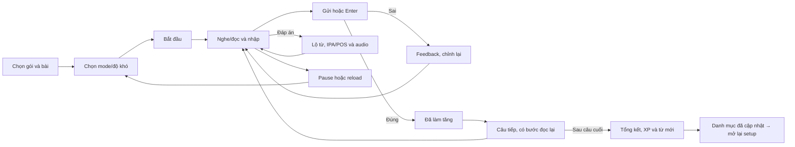

# Luồng người dùng đã quan sát

Các bước **OBSERVED** dựa trên thao tác trực tiếp hoặc trạng thái UI đã mở. Điểm dừng UNVERIFIED nằm trong từng nhánh. Các FR của sản phẩm mới có [user stories](../requirements/03-user-stories.md).

## Land, pháp lý và xác thực

- **Luồng** Landing → demo tile hoặc đăng nhập/đăng ký → email/mật khẩu, OAuth hoặc Khôi phục. Link footer mở hub pháp lý rồi hai trang chính. Màn đầu tự sang dashboard khi hydrate phiên.
- **Nhánh và giới hạn** Quan sát tới form. Register blank disabled. Chưa thử thông tin thật, đăng nhập thất bại, reset, email hoặc kiosk khách sau hydrate.
- **Nhóm tính năng** OBS-LAND-01, OBS-AUTH-01, OBS-AUTH-02, OBS-LEGAL-01.
- **Nguồn** [RT-01](06-evidence-and-screenshots.md#rt-01), [RT-02](06-evidence-and-screenshots.md#rt-02), [RT-03](06-evidence-and-screenshots.md#rt-03), [RT-04](06-evidence-and-screenshots.md#rt-04).

## Dashboard, hồ sơ, mục tiêu và XP

- **Luồng** Dashboard → kế hoạch hôm nay → lối mở bài; phút/goal → editor. Header → Cài đặt → profile/level/goal/voice/app/privacy. Streak → Tiến độ & Bạn bè → progress tuần, XP explainer hoặc Friends. Friend empty → tìm ID/gợi ý/link mời.
- **Nhánh và giới hạn** Tìm và settings quan sát ban đầu, không gửi. Nút Tìm disabled khi rỗng. XP modal cho biết sự kiện nhận XP, không suy ra tính XP.
- **Nhóm tính năng** OBS-DASH-01, OBS-DASH-02, OBS-SET-01, OBS-SET-02, OBS-SOC-01, OBS-SOC-02.
- **Nguồn** [RT-05](06-evidence-and-screenshots.md#rt-05), [RT-06](06-evidence-and-screenshots.md#rt-06), [RT-07](06-evidence-and-screenshots.md#rt-07), [RT-08](06-evidence-and-screenshots.md#rt-08), [RT-09](06-evidence-and-screenshots.md#rt-09), [RT-10](06-evidence-and-screenshots.md#rt-10).

## Điều hướng và góp ý

- **Luồng** Mobile tabbar → Menu → Phát âm, Từ điển, Tiến độ, Góp ý, Cài đặt. Utility nổi → thấy Từ điển nhanh. Góp ý → đổi tab Mới nhất hoặc Của tôi → empty.
- **Nhánh và giới hạn** Thông báo app có thể che menu; Để sau đóng. Form trống disabled; bình luận, bỏ phiếu và nộp chưa thử.
- **Nhóm tính năng** OBS-HELP-01, OBS-NAV-01.
- **Nguồn** [RT-11](06-evidence-and-screenshots.md#rt-11), [RT-12](06-evidence-and-screenshots.md#rt-12).

## Chọn bài, làm và tiếp tục Gõ câu

- **Luồng** Catalog → chọn cấp/chủ đề → gói/chương/bài → setup → Start → answer → feedback → next hoặc retry → mở lại qua setup. Cài đặt, tạm dừng và xem đáp án là các nhánh trong phiên.
- **Nhánh và giới hạn** Nghe/Nghe & nói dùng Nâng cao; nói dừng ở mic. Completion, XP, kho từ và mở lại tới setup đã kiểm ở bài A1. Ma trận bên dưới.
- **Nhóm tính năng** OBS-TY-01, OBS-TY-02, OBS-TY-03, OBS-TY-04, OBS-TY-05, OBS-TY-06, OBS-TY-07, OBS-TY-08.
- **Nguồn** [RT-13](06-evidence-and-screenshots.md#rt-13), [RT-14](06-evidence-and-screenshots.md#rt-14), [RT-15](06-evidence-and-screenshots.md#rt-15), [RT-16](06-evidence-and-screenshots.md#rt-16), [RT-17](06-evidence-and-screenshots.md#rt-17), [RT-18](06-evidence-and-screenshots.md#rt-18), [RT-19](06-evidence-and-screenshots.md#rt-19), [RT-20](06-evidence-and-screenshots.md#rt-20).

## Từ vựng và ôn tập

- **Luồng** Catalog → Oxford → CEFR/chủ đề → chọn Nạp sâu/nhanh. Deep: phân loại Bỏ qua/Học/Biết rồi, đủ 5 → gõ chép. Fast: đảo chiều → lật → thấy bốn mức; kết thúc sớm → tổng kết. Kho của tôi → due trống, form bộ riêng hoặc AI.
- **Nhánh và giới hạn** Rating thật và lịch đến hạn bền vững chưa quan sát; có đường kết thúc sớm 0 từ. Form tạo bộ hủy.
- **Nhóm tính năng** OBS-VOCAB-C01, OBS-VOCAB-C02, OBS-VOCAB-C03, OBS-VOCAB-C04, OBS-VOCAB-C05.
- **Nguồn** [CV-01](06-evidence-and-screenshots.md#cv-01), [CV-02](06-evidence-and-screenshots.md#cv-02), [CV-03](06-evidence-and-screenshots.md#cv-03), [CV-04](06-evidence-and-screenshots.md#cv-04), [CV-05](06-evidence-and-screenshots.md#cv-05).

## Ngữ pháp và lộ trình

- **Luồng** Grammar → lộ trình/cốt lõi → bài → tài liệu hoặc guided → ví dụ → choice. Roadmap → chapter 2 → bài kế, hoặc modal mục tiêu/đổi cấp, hoặc tổng quan kiểm tra lên cấp.
- **Nhánh và giới hạn** Bài 20 câu locked ở 0/3. Một bài chương sau truy cập. Chưa nộp guided do auto-review. Kiểm tra cấp dừng trước Start.
- **Nhóm tính năng** OBS-GRAM-C06, OBS-GRAM-C07, OBS-GRAM-C08, OBS-ROAD-C09, OBS-ROAD-C10.
- **Nguồn** [CV-06](06-evidence-and-screenshots.md#cv-06), [CV-07](06-evidence-and-screenshots.md#cv-07), [CV-08](06-evidence-and-screenshots.md#cv-08), [CV-09](06-evidence-and-screenshots.md#cv-09), [CV-10](06-evidence-and-screenshots.md#cv-10).

## Đọc và dịch

- **Luồng** Hub → câu ngẫu nhiên/theo bài hoặc topic/nhà xuất bản. Câu: hint → đúng/sai → chấm lại/giải thích → next. Đoạn: Chỉ đọc, song ngữ và click từ → chọn chiều dịch → nhập/draft → xác nhận → loading → rubric → history. Bài riêng có modal URL/text/AI.
- **Nhánh và giới hạn** History cả đoạn đã kiểm qua hub, bản dịch còn khi vào lại. Bài mới không tạo. Provider AI/score và CEFR mapping chưa xác minh.
- **Nhóm tính năng** OBS-READ-M01, OBS-TRANS-M02, OBS-TRANS-M03, OBS-TRANS-M04, OBS-READ-M05, OBS-READ-M06, OBS-TRANS-M07, OBS-TRANS-M08, OBS-READ-M09, OBS-READ-M10.
- **Nguồn** [MV-01](06-evidence-and-screenshots.md#mv-01), [MV-02](06-evidence-and-screenshots.md#mv-02), [MV-03](06-evidence-and-screenshots.md#mv-03), [MV-04](06-evidence-and-screenshots.md#mv-04), [MV-05](06-evidence-and-screenshots.md#mv-05), [MV-06](06-evidence-and-screenshots.md#mv-06), [MV-07](06-evidence-and-screenshots.md#mv-07), [MV-08](06-evidence-and-screenshots.md#mv-08), [MV-09](06-evidence-and-screenshots.md#mv-09), [MV-10](06-evidence-and-screenshots.md#mv-10).

## Video, dictation, shadowing và quiz

- **Luồng** Filter A1–A2 → chọn video → modal mode. Dictation: cue/tốc độ/loop → sai/sửa → đúng. Subtitles: cue, Bản dịch/IPA. Shadowing: CTA ghi và input mic. Quiz: chọn/mở nộp → điểm/lời giải/Làm lại.
- **Nhánh và giới hạn** Nhập thiếu quiz vẫn nộp được sau một chọn. Dictation 1→0 khi đổi mode. Shadowing ghi âm và hoàn tất video chưa xác minh.
- **Nhóm tính năng** OBS-VIDEO-M11, OBS-VIDEO-M12, OBS-VIDEO-M13, OBS-VIDEO-M14, OBS-VIDEO-M15.
- **Nguồn** [MV-11](06-evidence-and-screenshots.md#mv-11), [MV-12](06-evidence-and-screenshots.md#mv-12), [MV-13](06-evidence-and-screenshots.md#mv-13), [MV-14](06-evidence-and-screenshots.md#mv-14), [MV-15](06-evidence-and-screenshots.md#mv-15).

## Từ điển và IPA

- **Luồng** Search → autocomplete → từ/cụm → nghĩa/audio/collocations → modal lưu có prefill. IPA → giọng UK/US → âm → minimal pairs → nghe chọn → feedback → tiếp.
- **Nhánh và giới hạn** Lưu vào thẻ, audio quality, SRS connection và hoàn tất âm chưa xác minh. Có chuyển và khôi phục giọng.
- **Nhóm tính năng** OBS-DICT-M16, OBS-DICT-M17, OBS-IPA-M18, OBS-IPA-M19.
- **Nguồn** [MV-16](06-evidence-and-screenshots.md#mv-16), [MV-17](06-evidence-and-screenshots.md#mv-17), [MV-18](06-evidence-and-screenshots.md#mv-18), [MV-19](06-evidence-and-screenshots.md#mv-19).

## Ma trận Gõ câu

Bài chính A1 trên RT-14–20. Dùng số mục theo mode tại thời điểm chạy.

| # | Ca | Thao tác thực tế | Kết quả và phạm vi |
|---:|---|---|---|
| 1 | Đúng | Nhập đúng mục từ đầu ở Mặc định Cơ bản, Enter. | OBSERVED · Chính xác; Đã làm 0→1 trong bộ 49 mục. |
| 2 | Sai một từ | Trong A1 Nâng cao, dùng câu thứ hai và thay địa danh bằng từ khác. | OBSERVED · Sai, thử lại; input và cursor giữ nguyên; Đã làm vẫn 1. |
| 3 | Thiếu một từ | Bỏ từ chỉ quan hệ trong cùng câu. | OBSERVED · Sai, thử lại; cùng cursor. |
| 4 | Dư một từ | Thêm một từ ở cuối cùng câu. | OBSERVED · Sai, thử lại; cùng cursor. |
| 5 | Khác dấu/chữ hoa/khoảng trắng | Nhập câu thứ nhất all lowercase, bỏ dấu phẩy/chấm. Sửa câu thứ hai bằng spacing khác. | OBSERVED · Cả hai được chấp nhận; ô câu thứ hai hiển thị dạng đã chuẩn hóa. Giới hạn hai mẫu. |
| 6 | Trống | Công cụ auto-review từ chối nhấn Enter trên ô trống trong tài khoản. | UNVERIFIED · Có thể ghi attempt. Đã yêu cầu xác nhận riêng cho đúng thao tác, chưa lặp. |
| 7 | Enter | Dùng Enter cho từ đúng và câu đúng đã sửa. | OBSERVED · Có feedback và đếm tăng, chưa kiểm Ctrl/Alt ngoài nhãn. |
| 8 | Reload | Sau hai câu đúng Nâng cao, reload. Sau đó chọn Nghe và Start. | OBSERVED · Setup trước, đếm 0 tạm thời, vào bài hiện 2/24 đã làm và Câu 2. |
| 9 | Hoàn thành | Từ câu 3 dùng Đáp án để đọc mẫu, nhập lại và gửi từng câu đến 24/24. Bấm Tiếp tục sau câu cuối. | OBSERVED · Tổng kết +30 XP, combo 5, Chính xác 0%, +8 từ mới và lên cấp 2. Các câu đúng sau khi xem mẫu là thực hành có trợ giúp. Công thức chính xác và combo chưa xác minh. |
| 10 | Quay lại | Mở danh mục A1 trong lúc dở và bằng Về danh sách sau khi hoàn tất. Chọn lại bài đã hoàn thành. | OBSERVED · 8% giữa chừng, sau đó 1/84 hoàn tất. Badge Trọn bộ nói Nâng cao tính đủ ba độ khó. Chọn lại mở setup Nâng cao, chưa bấm Bắt đầu lượt mới. |

### Trạng thái và điều khiển

Bài mở thứ hai ở chủ đề Du lịch dùng Trung cấp, hiện ô nhập ở mục 1/83. Bài A1 Luyện nghe ẩn nghĩa và có replay; Nghe & nói hiện CTA mic và Enter trong hướng dẫn. Player settings gồm tốc độ 0.8×, 1×, 1.2×, tự đọc, cỡ chữ, IPA/POS và âm thanh. Chỉ xác nhận kích hoạt nút audio; âm nghe thực tế chưa đo. [RT-14–20](06-evidence-and-screenshots.md#rt-14)

[Danh mục chức năng](02-feature-inventory.md) · [Các phần còn UNVERIFIED](07-unverified-features.md)
